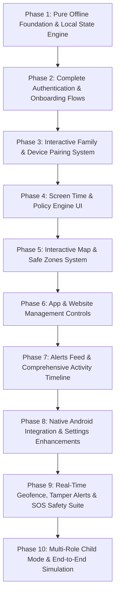

# HAVEN PARENTAL CONTROL — FRONTEND IMPLEMENTATION ROADMAP
## 100% Offline-First Foundation & Pure Local Architecture Roadmap

**Document Version:** 1.0.0  
**Audit Date:** 2026-11-05  
**Target Platform:** Flutter (Android Parent & Child) / GetX Architecture  
**Execution Standard:** Pure Frontend First (Zero Cloud Dependency Before Offline Verification)  

---

## 1. ARCHITECTURAL PHILOSOPHY & OFFLINE-FIRST STRATEGY

The HAVEN frontend architecture is designed to enforce a strict boundary: **the application must function as a complete, deterministic, offline-capable client before any live cloud services (Supabase or Firebase) are reached.**

Currently, the application contains 172 discrete product features across Modules A through M. While the core GetX shell, UI vocabulary, and refusal architecture are established, numerous product mutations are blocked at backend seams or refuse execution due to undeployed Edge Functions and grant walls.

This roadmap specifies the ordered sequence of pure frontend implementation phases to transform HAVEN into a **100% functional offline product** using:
1. **Offline Repository Pattern & Fake Backends**: In-memory and disk-persisted fakes implementing domain repositories.
2. **Local Persistence Engine**: `PreferencesStore` (SharedPreferences), `SecureVault` (FlutterSecureStorage), and typed local state stores.
3. **Synthetic Telemetry & Mock Feed Generators**: Configurable simulated child devices emitting realistic battery, app usage, and location fixes for offline validation.
4. **GetX State & Navigation Binding**: Modular `Bindings`, reactive `Rx` controllers, clean navigation stacks without hardcoded literals.

---

## 2. STATUS BREAKDOWN & PHASE HIGHLIGHTS

Across the 172 cataloged features:
- **COMPLETE (Offline Verified):** 73 features (42.44%)
- **NOT IMPLEMENTED:** 57 features (33.14%)
- **PARTIAL:** 18 features (10.47%)
- **PLACEHOLDER (Refusal Stubs):** 17 features (9.88%)
- **UI ONLY:** 7 features (4.07%)

The roadmap is structured into **10 Sequential Phases** to systematically close all gaps.

---

## 3. ORDERED IMPLEMENTATION PHASES

### PHASE 1: Pure Offline Foundation & Local State Engine
**Objective:** Establish offline-first data stores and an in-memory test harness so all 13 modules can execute mutations locally without backend errors.

- **Tasks:**
  1. Enhance `OfflineBackends` (`packages/haven_api/lib/src/offline_backends.dart`) to support stateful in-memory tables for `families`, `profiles`, `devices`, `device_policies`, `safe_zones`, and `usage_daily`.
  2. Implement an offline toggle in `HavenConfig` allowing the app to run in standalone demo/offline mode.
  3. Wire local storage persistence so offline mutations persist across app restarts using `PreferencesStore`.
  4. Create a synthetic telemetry generator capable of producing simulated child location events, app usage durations, and battery updates.
- **Dependencies:** `haven_core`, `haven_models`, `haven_api`.
- **Acceptance Criteria:**
  - App launches cleanly in offline mode with zero `--dart-define` keys provided.
  - CRUD operations succeed in local memory and persist to disk.
  - All widget tests pass without mock network exceptions.

---

### PHASE 2: Complete Authentication & Onboarding Flows
**Objective:** Deliver an end-to-end parent account creation, password recovery, and multi-step onboarding wizard.

- **Tasks:**
  1. Build `WelcomePage` (AUTH-02) with 3-slide value proposition carousel.
  2. Build `ForgotPasswordPage` (AUTH-05) and `ResetPasswordPage` (AUTH-06) with input validation.
  3. Expand `OnboardingPage` (ONBD-04 to ONBD-10) with a 4-step progressive stepper:
     - Step 1: Ethics & Monitoring Disclosure
     - Step 2: Family Naming
     - Step 3: Child Profile Creation (Name, Age Bracket, Avatar)
     - Step 4: Device Setup Walkthrough
  4. Build Onboarding Celebratory Completion Screen (ONBD-10).
  5. Implement onboarding step resumption in `PreferencesStore` (ONBD-11).
- **Dependencies:** Phase 1 (Local state storage).
- **Acceptance Criteria:**
  - Parent can complete onboarding, create a family and initial child profile offline.
  - Step progress indicator updates smoothly; back/skip controls work.
  - Closing app mid-onboarding resumes at the exact step upon relaunch.

---

### PHASE 3: Interactive Family & Device Pairing System
**Objective:** Replace pairing refusal notices with a fully functional 6-digit PIN generator, QR code display/scanner, and device management suite.

- **Tasks:**
  1. Implement 6-Digit Pairing PIN Generator & Countdown Timer widget (PAIR-02, PAIR-05).
  2. Implement Pairing QR Code generator using `qr_flutter` (PAIR-03).
  3. Build manual 6-cell PIN input form for parent pairing (PAIR-04).
  4. Build Pairing Success confirmation screen (PAIR-07) showing device specs.
  5. Add Device Rename modal dialog (PAIR-13).
  6. Implement executable Device Revoke and Reconnect triggers in local repository (PAIR-14, PAIR-15).
  7. Add Add-Child modal dialog to Family Dashboard (FAM-03) and Child Profile Editor (FAM-05).
- **Dependencies:** Phase 2 (Family and Child records).
- **Acceptance Criteria:**
  - Parent can generate a pairing PIN with live 15-minute countdown clock.
  - Simulating child pairing establishes device link and updates device directory immediately.
  - Unlinking a device removes it from active list with undo/confirmation.

---

### PHASE 4: Screen Time & Policy Engine UI
**Objective:** Implement comprehensive screen time tracking, usage visualizers, daily limit pickers, and downtime schedule editors.

- **Tasks:**
  1. Build Daily Screen Time Aggregated Meter widget (TIME-01) with progress ring.
  2. Implement 7-day Weekly Screen Time Bar Chart (TIME-02) with daily averages.
  3. Build Daily Screen Time Limit duration picker dialog (TIME-04) with weekday/weekend split.
  4. Build Bedtime / Downtime Schedule editor (TIME-06) with start/end time pickers and day recurrence chips (TIME-09, TIME-10).
  5. Build School Hours focus schedule editor (TIME-07) with app category whitelist.
  6. Build Custom Schedule creation form (TIME-08) and master active toggle (TIME-11).
  7. Implement Lockout Screen preview (TIME-13) and "Grant 15m Extension" action.
- **Dependencies:** Phase 3 (Paired devices).
- **Acceptance Criteria:**
  - Daily usage meter calculates totals from app usage rows accurately.
  - Parent can configure Bedtime and School schedules with validation preventing invalid time windows.
  - Schedule toggles persist state locally and reflect in policy version cards.

---

### PHASE 5: Interactive Map & Safe Zones System
**Objective:** Replace coordinate text fields with an interactive map UI, address search, geofence radius slider, and geofence transition cards.

- **Tasks:**
  1. Integrate interactive map component (`flutter_map` with OpenStreetMap raster tiles) (LOC-02).
  2. Render child location pin with accuracy radius circle on map (LOC-01).
  3. Build Add Safe Zone interactive flow (LOC-08) with map pin drop and address search geocoder.
  4. Implement Geofence Radius Selection Slider (LOC-10) with dynamic map circle scaling (20m to 5000m).
  5. Render safe zone overlays on map with color-coded status (active/paused).
  6. Build Historical Route Breadcrumb playback bar (LOC-05).
  7. Connect Safe Zone Entry/Exit event cards (LOC-12).
- **Dependencies:** Phase 3 (Paired devices).
- **Acceptance Criteria:**
  - Map pans, zooms, and centers on child location pin cleanly offline.
  - Parent can create a new safe zone by tapping the map and dragging radius slider.
  - Editing or deleting a safe zone updates map overlays immediately.

---

### PHASE 6: App & Website Management Controls
**Objective:** Build installed application directory, per-app restriction rules, app category manager, and website domain allowlist/blocklist.

- **Tasks:**
  1. Build Installed Applications Directory screen (APP-01) reading `device_apps`.
  2. Implement app categorization engine (Games, Social, Video, Education) (APP-03).
  3. Build App Detail Inspector (APP-02) with daily usage and launch frequency.
  4. Implement Tri-State App Access Rule toggle (Always Allowed, Restricted, Blocked) (APP-04).
  5. Add search bar and category filter chips to app directory (APP-06, APP-07).
  6. Build Website Filtering Dashboard (APP-09) with master Web Protection switch and SafeSearch toggle.
  7. Build Domain Allowlist & Blocklist manager (APP-10) with Add Domain dialog (APP-11) and URL validation.
  8. Wire policy compiler to generate unified policy JSON bundles (APP-08, APP-15).
- **Dependencies:** Phase 4 (Policy engine).
- **Acceptance Criteria:**
  - Installed apps directory displays icons, names, and categories.
  - Toggling an app to "Blocked" compiles into policy bundle and updates status chip.
  - Invalid domain names (e.g. malformed URLs) are rejected with clear error captions.

---

### PHASE 7: Alerts Feed & Comprehensive Activity Timeline
**Objective:** Build a unified activity timeline, alert filters, acknowledge/clear actions, and notification preferences.

- **Tasks:**
  1. Implement unread filter toggle on Notifications page (ALRT-05).
  2. Build executable Mark Alert as Read / Acknowledged action (ALRT-06).
  3. Build Dismissible alert tiles and Clear All action (ALRT-07).
  4. Build Unified Chronological Activity Timeline page (ALRT-08) merging location fixes, app launches, and policy updates.
  5. Add date range filter (Today, Yesterday, Last 7 Days) and event type filters (ALRT-09).
  6. Connect notification preference toggles in Settings (ALRT-11, SET-05).
- **Dependencies:** Phases 4, 5, 6 (Alerts and activity sources).
- **Acceptance Criteria:**
  - Alerts can be acknowledged and cleared from UI with reactive counter updates.
  - Unified timeline correctly interleaves diverse event types in reverse chronological order.

---

### PHASE 8: Native Android Integration & Settings Enhancements
**Objective:** Enhance Kotlin native bridge to support platform intent deep links, runtime permission request prompts, and settings features.

- **Tasks:**
  1. Implement MethodChannel launcher in `HavenBridge.kt` to trigger Android Settings intents (PERM-12):
     - `Settings.ACTION_USAGE_ACCESS_SETTINGS`
     - `Settings.ACTION_REQUEST_IGNORE_BATTERY_OPTIMIZATIONS`
     - `DevicePolicyManager.ACTION_ADD_DEVICE_ADMIN`
  2. Add runtime permission prompt triggers for `POST_NOTIFICATIONS` and `ACCESS_FINE_LOCATION` (PERM-04, PERM-05).
  3. Declare `SYSTEM_ALERT_WINDOW` in `AndroidManifest.xml` and add overlay detection reader in Kotlin (PERM-07).
  4. Build Child Device Setup Progress Stepper widget (PERM-10).
  5. Build Legal Document Viewers for Privacy Policy (SET-08) and Terms of Service (SET-09).
  6. Build Help Center and FAQ Accordion Viewer (SET-10, SET-11).
  7. Build Contact Support & Diagnostic Report Mailer (SET-12).
- **Dependencies:** Phase 1 (Native platform channel).
- **Acceptance Criteria:**
  - Tapping "Open Phone Settings" successfully launches the corresponding Android system screen.
  - Permission status updates in real time upon returning to the app.

---

### PHASE 9: Real-Time Geofence, Tamper Alerts & SOS Safety Suite
**Objective:** Deliver high-priority safety mechanisms: geofence transition alerts, anti-tamper notifications, and emergency SOS panic system.

- **Tasks:**
  1. Build in-app animated Geofence Entry/Exit banner (FEAT-01).
  2. Implement anti-tamper alert trigger in Kotlin `HavenDeviceAdminReceiver` when admin revocation is attempted (FEAT-02, FEAT-03).
  3. Build Child Emergency SOS Panic Button widget with 3-second hold gesture (FEAT-04).
  4. Build Parent Emergency SOS Fullscreen Alert Modal with audible siren tone and direct location map routing (FEAT-05).
  5. Implement Offline Data Queue indicator pill in `HavenScaffold` (FEAT-06).
  6. Build Security & Administrative Audit Log Explorer (FEAT-07).
  7. Add Biometric/PIN App Lock for parent settings (FEAT-09).
- **Dependencies:** Phases 5, 7, 8.
- **Acceptance Criteria:**
  - Holding Child SOS button dispatches high-priority beacon to local repository.
  - Parent app renders fullscreen alarm modal with siren audio trigger.
  - Attempting to revoke Device Admin generates critical tamper alert.

---

### PHASE 10: Multi-Role Child Mode & End-to-End Offline Simulation
**Objective:** Provide role-based child dashboard views, demo scenario switcher, and a comprehensive end-to-end automated UI widget test suite.

- **Tasks:**
  1. Build dedicated `ChildDashboardPage` (FEAT-08) showing remaining screen time, allowed apps, and active safe zones for child view.
  2. Implement role-switcher in debug/demo drawer allowing instant toggling between Parent Mode and Child Mode.
  3. Implement automated demo scenario generator (e.g. "Typical School Day", "Weekend Gaming Limit Reached", "Geofence Exit Alert").
  4. Author end-to-end widget test suite covering all 172 features against the offline fake backend harness.
  5. Run `dart run scripts/check_line_counts.dart` to verify strict compliance with the <= 200 line limit.
- **Dependencies:** All previous phases.
- **Acceptance Criteria:**
  - 100% of features reachable and interactive in pure offline mode.
  - Child role sees restricted child-appropriate UI without parent administration controls.
  - 100% of tests pass cleanly with zero network dependencies.

---

## 4. VERIFICATION GATES & MILESTONE SCHEDULE

| Gate | Phase Scope | Primary Deliverable | Success Criteria |
|---|---|---|---|
| **Gate 1: Core Shell & Storage** | Phase 1 & 2 | Offline auth & onboarding | Parent creates family & child profile completely offline |
| **Gate 2: Pairing & Device Control** | Phase 3 & 4 | PIN/QR pairing & screen time | 6-digit PIN generated with timer; Bedtime schedule configured |
| **Gate 3: Geofences & Content Filter** | Phase 5 & 6 | Interactive map & app blocking | Geofence created on map; apps toggled between allow/block |
| **Gate 4: Safety & Native Platform** | Phase 7 & 8 | Alerts feed & settings deep links | Intent opens Android settings; alerts acknowledged |
| **Gate 5: Emergency SOS & Child Mode** | Phase 9 & 10 | SOS siren, anti-tamper, child view | SOS alarm triggers siren; 100% offline verification passed |

Following this roadmap ensures that HAVEN possesses a flawless, enterprise-grade frontend foundation before any backend edge functions, secrets, or cloud database tables are deployed.
