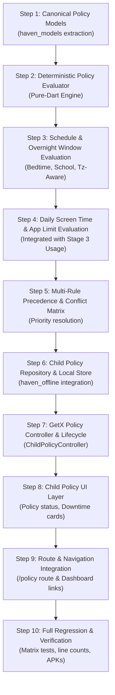

# HAVEN STAGE 4 — PROPOSED IMPLEMENTATION ROADMAP
## Pure-Dart Deterministic Policy Evaluation Engine (E)

**Document Version:** 1.0.0-PROPOSED  
**Date:** November 17, 2026  
**Repository:** `D:\control`  
**Status:** PROPOSAL ONLY — IMPLEMENTATION AWAITING OWNER AUTHORIZATION  
**Author:** Antigravity Engineering

---

## 1. Executive Summary & Objective

In accordance with `docs/implementation/phase_3/PHASE_3_MASTER_PLAN.md` §4, Stage 4 encompasses the **Policy Evaluation Engine (E)**. 

Stage 4 establishes a **pure-Dart deterministic evaluator** that evaluates child device policies against current time, calendar schedules, and active usage statistics. 

Crucially, Stage 4 is strictly decoupled from native app blocking or enforcement (which is owned by Stage 5's Feasibility Audit). The engine calculates whether an app or the device is *within restriction*, but makes **zero claims of enforcement** until platform enforcement mechanisms are authorized and implemented.

---

## 2. Feature Candidate Analysis

| Candidate Feature | Purpose | Status | Dependencies | Android Permissions | Privacy Impact | Complexity | Recommended Priority |
|:---|:---|:---:|:---:|:---:|:---:|:---:|:---:|
| **F-1: Canonical Policy Models** | Unify `PolicyConfig` / `PolicySchedule` across parent and child apps | In Parent only | `haven_models` | None | None | Low | **Critical (Step 1)** |
| **F-2: Pure-Dart Policy Evaluator** | Calculate active allowance/restriction state for any app/device at a given time | New | F-1, `haven_core` (Clock) | None | None (pure math/logic) | Medium | **Critical (Step 2–5)** |
| **F-3: Child Local Policy Store** | Persist received/default policy configuration in `haven_local.json` | New | `haven_offline` | None | Local document store | Low | **High (Step 6)** |
| **F-4: Child Policy Controller & UI** | Display active schedules, app limits, and current restriction status to child | New | F-2, F-3, Stage 3 Usage | None | Transparent disclosure | Medium | **High (Step 7–9)** |
| **F-5: Friendly App Name/Icon Reader** | Resolve `com.android.chrome` to "Chrome" and display app icon | New | Android Bridge | `QUERY_ALL_PACKAGES` or specific package query | Read installed app list | High | **Medium (Post-Stage 4)** |
| **F-6: Active App Blocking (Enforcement)** | Suspend or terminate restricted applications | Deferred | Device Owner / Accessibility | `SYSTEM_ALERT_WINDOW` or Device Admin | High (intrusive) | Very High | **Deferred to Stage 5** |
| **F-7: Real Parent-Child Sync** | Real-time policy sync between parent device and child device | Blocked (B-1) | Backend Transport | Internet / Network | Cloud data flow | High | **Deferred (Phase 4)** |

---

## 3. Detailed Stage 4 Step-by-Step Breakdown

### Step 1: Canonical Policy Models Extraction
- **Scope:** Lift `PolicyConfig`, `PolicySchedule`, `PolicyScheduleType`, and `AppLimit` from `apps/haven_app/lib/features/policies/data/` into `packages/haven_models/lib/src/`. Re-export from `haven_models.dart`.
- **Acceptance:** Parent app tests pass without alteration; child app can consume identical typed models; serialization roundtrips verified.
- **Constraints:** Strict $\le 200$ lines per file.

### Step 2: Deterministic Policy Evaluator Core
- **Scope:** Implement `PolicyEvaluator` in `packages/haven_core/` or `apps/haven_child/lib/features/policies/domain/`.
- **Inputs:** `PolicyConfig`, `DateTime evaluationTime`, `Duration totalDailyUsage`, `Map<String, Duration> appUsages`.
- **Outputs:** `PolicyEvaluationResult` detailing:
  - `isDeviceRestricted` (bool)
  - `activeSchedules` (List<PolicySchedule>)
  - `isAppRestricted(String packageName)` (EvaluationDecision: allowed, blockedBySchedule, blockedByLimit, blockedByDefault)
  - `remainingScreenTime` (Duration)
  - `remainingAppTime(String packageName)` (Duration)
- **Acceptance:** 100% deterministic unit tests using `FixedClock`.

### Step 3: Schedule Interval & Overnight Window Evaluation
- **Scope:** Comprehensive evaluation of complex recurring windows:
  - Normal daytime windows (e.g. 08:30 to 15:00).
  - Overnight bedtime windows crossing midnight (e.g. 21:00 to 07:00 next day).
  - Day-of-week recurrence (weekdays vs weekends).
  - Timezone shift and local calendar boundary preservation.
- **Acceptance:** Unit tests covering pre-window, inside-window, post-window, midnight cross, and timezone shifts.

### Step 4: Daily Quota & App Limit Evaluation
- **Scope:** Compare transient `UsageDailyResult` against `dailyScreenTimeMinutes` and `appLimits`.
- **Behavior:**
  - When `totalDailyUsage >= dailyScreenTimeMinutes`, mark device restricted (except exempt emergency apps).
  - When per-app usage exceeds `appLimits[pkg]`, mark that package restricted.
- **Acceptance:** Tested against boundary conditions (0m, limit - 1m, exact limit, limit + 1m).

### Step 5: Multi-Rule Precedence & Conflict Matrix
- **Scope:** Implement strict conflict resolution order:
  1. **Emergency / Always Allowed Apps** (e.g. Phone, Emergency Dialer) $\rightarrow$ Never restricted.
  2. **Active Schedule Block** (e.g. Bedtime downtime) $\rightarrow$ Restricted unless explicitly on schedule's allowed list.
  3. **Explicit Blocked Apps** (`blockedApps`) $\rightarrow$ Restricted always.
  4. **Per-App Time Limit Exceeded** $\rightarrow$ Restricted.
  5. **Daily Total Screen Time Exceeded** $\rightarrow$ Restricted.
  6. **Default State** $\rightarrow$ Allowed.
- **Acceptance:** Comprehensive test matrix verifying every branch of the precedence chain.

### Step 6: Child Policy Repository & Local Store
- **Scope:** Implement `ChildPolicyRepository` using `haven_offline` document storage (`haven_local.json`).
- **Behavior:** Reads persisted policy document; provides fallback to canonical default policy (`PolicyConfig.defaults()`) if no custom policy is saved.
- **Acceptance:** Document roundtrip tests, malformed recovery tests, atomic flush tests.

### Step 7: GetX Policy Controller & Lifecycle Integration
- **Scope:** Implement `ChildPolicyController` observing both `ChildUsageController` and `ChildPolicyRepository`.
- **Behavior:** Re-evaluates restriction status whenever usage data refreshes or lifecycle resumes.
- **Acceptance:** Unit tests with fake repositories and fake clocks.

### Step 8: Child Policy UI Layer
- **Scope:** Create `ChildPolicyPage` displaying:
  - Current status banner ("Free to use" or "Downtime active").
  - Remaining daily screen time.
  - Active schedules (Bedtime / School Hours).
  - Per-app time limits and remaining allowances.
  - Transparent disclosure: *"Evaluated locally on this device — active app blocking is not enforced in this build."*
- **Acceptance:** Widget state tests covering all policy states, dark theme, accessibility semantics.

### Step 9: Route & Navigation Integration
- **Scope:** Register `ChildRoutes.policy = '/policy'` in `ChildPages.pages`. Connect "Policy" row on Permissions / Device Dashboard to `/policy`.
- **Acceptance:** Navigation widget tests; architecture route whitelist assertion.

### Step 10: Full Regression & Verification
- **Scope:** Run full repository test suite (expected $>1,450$ tests), analyzers, line-count audits, and APK builds.
- **Acceptance:** 0 failures, 0 skips, 0 analyzer issues, 0 line violations.

---

## 4. Testing Strategy

1. **Deterministic FixedClock Tests:** All evaluation tests must inject `FixedClock` to evaluate exact date-time scenarios without dependency on system wall clock.
2. **Boundary Testing Matrix:**
   - 23:59:59 to 00:00:00 midnight transitions.
   - 20:59 to 21:00 bedtime transitions.
   - Weekday to weekend schedule changes.
   - Leap year and month boundaries.
3. **Architecture Isolation:** Evaluator unit tests must reside in pure Dart package tests (`packages/haven_core` or `haven_child/test/features/policies/`), running with zero emulator or native dependencies.

---

## 5. Risk Assessment & Rollback Plan

- **Risk: User Confusion regarding App Blocking:**
  - *Mitigation:* The UI must prominently carry an honest status banner stating that policy limits are evaluated locally for informational purposes, and app suspension is not active without Device Owner provisioning.
- **Risk: Breaking Parent Policy Format:**
  - *Mitigation:* Lifting `PolicyConfig` to `haven_models` must be verified against parent tests (`apps/haven_app/test/policies/`) to guarantee 100% backward compatibility.
- **Rollback Strategy:** Because Stage 4 is pure Dart logic layered on top of existing Stage 3 models, rolling back any step involves zero database schema migrations and zero native Kotlin changes.

---

## 6. Authorization Boundary

> [!IMPORTANT]
> **THIS ROADMAP IS A PROPOSAL ONLY.**  
> No implementation work will commence without explicit, step-by-step owner authorization.
