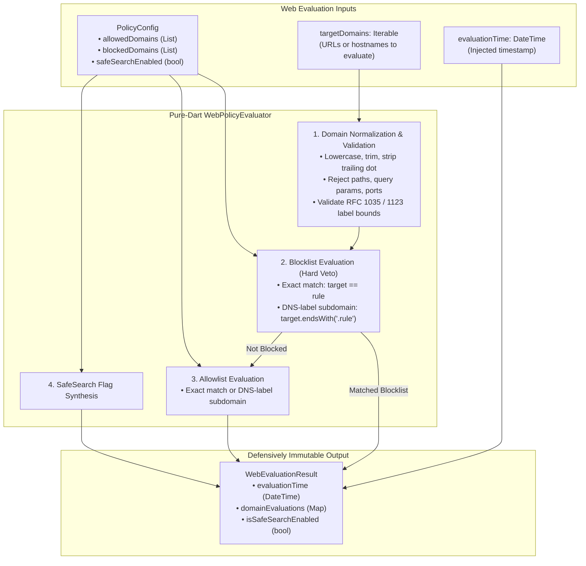
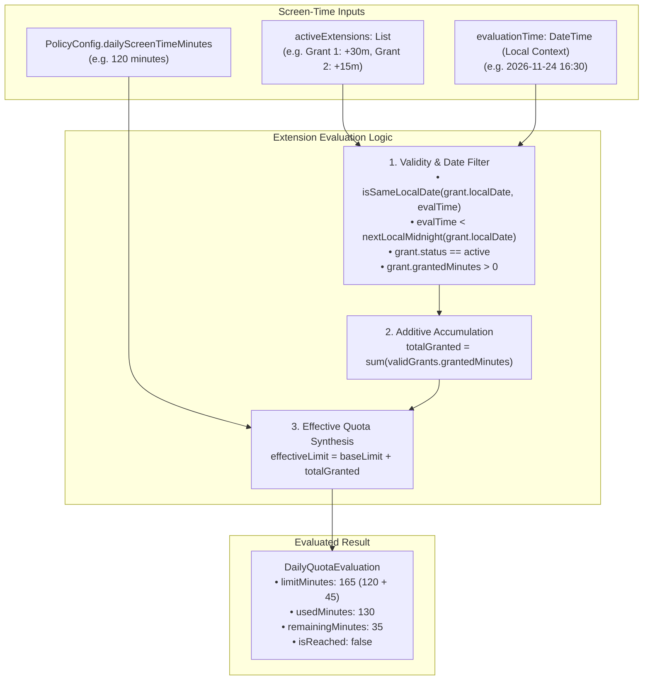

# HAVEN STAGE 4 — STEP 5
## MULTI-RULE PRECEDENCE & FORMAL ARCHITECTURAL SPECIFICATION

**Document Version:** 1.0.0-PROPOSED-SPECIFICATION  
**Ratification Date:** November 24, 2026  
**Repository:** `D:\control`  
**Accepted Checkpoint HEAD:** `6ae46f567de4772d3252215b19e5302a3d255071`  
**Milestone:** Stage 4 Step 5 — Sub-step 5.2  
**Status:** SPECIFICATION SYNCHRONIZATION ONLY — ZERO IMPLEMENTATION AUTHORIZATION  
**Author:** Antigravity Engineering  

---

## 1. Executive Summary & Purpose

This authoritative technical specification establishes the formal architectural contracts, precedence rules, conflict resolution behaviors, and interface schemas for **HAVEN Stage 4 Step 5 (Multi-Rule Precedence & Conflict Matrix)**.

It incorporates all owner decisions ratified during Sub-Step 5.1 (Decisions 5.1 through 5.4), reconciles them with existing pure-Dart evaluator contracts from Stage 4 Step 2, and strictly preserves every accepted invariant from Stage 4 Step 4.

> [!IMPORTANT]
> **GOVERNANCE & EXECUTION BOUNDARY:**  
> This document constitutes an architectural and specification deliverable only. It **does NOT authorize** production implementation, test creation, database migrations, cloud configuration, or Git mutations. Implementation will proceed only under explicit subsequent owner authorization.

---

## 2. Section A: Authoritative Ratified Decision Register

The following decisions were formally approved by the project owner on **November 24, 2026** against checkpoint `6ae46f567de4772d3252215b19e5302a3d255071`:

| Decision ID | Canonical Title | Status | Ratification Date | Authoritative Core Contract |
|:---|:---|:---:|:---:|:---|
| **Decision 5.1** | **Dedicated `WebPolicyEvaluator` Engine** | **RATIFIED (Option A)** | 2026-11-24 | Standalone pure-Dart web evaluator. Separate `WebEvaluationResult` and `DomainEvaluation` models. Zero coupling to Android `USAGE_STATS` or app evaluators. $\le 200$ lines per file. |
| **Decision 5.1-S1** | **`blockedDomains` Absolute Hard Veto** | **RATIFIED (Option A)** | 2026-11-24 | `blockedDomains` unconditionally overrides `allowedDomains`. Dual-listed domains evaluate strictly as `blockedByParent`. |
| **Decision 5.1-S2** | **DNS-Label-Boundary Subdomain Inheritance** | **RATIFIED (Option A)** | 2026-11-24 | Subdomain matching respects DNS label boundaries (`example.com` matches `example.com` and `sub.example.com`; rejects `badexample.com`). Allowing a subdomain does not unblock root. |
| **Decision 5.2-1** | **Additive Screen-Time Extensions** | **RATIFIED (Option A)** | 2026-11-24 | Granted extensions accumulate additively: $effectiveDailyLimit = dailyScreenTimeMinutes + \sum grantedMinutes$. Multiple daily grants sum together. |
| **Decision 5.2-2** | **Bedtime Absolute Supremacy** | **RATIFIED (Option A)** | 2026-11-24 | Bedtime restrictions maintain supremacy over extensions. Active Bedtime locks down non-emergency apps regardless of unspent extension minutes. |
| **Decision 5.2-3** | **Local-Midnight Expiration** | **RATIFIED (Option A)** | 2026-11-24 | Extensions expire strictly at the exclusive next-local-midnight boundary (`00:00:00`). Zero carry-over into the next calendar day. |
| **Decision 5.2-4** | **Global Daily Quota-Only Scope** | **RATIFIED (Option A)** | 2026-11-24 | Extensions modify only the global daily screen-time quota; they do not alter explicit per-app limits in `PolicyConfig.appLimits`. |
| **Decision 5.3** | **Defer Category Limits to Stage 6** | **RATIFIED (Option A)** | 2026-11-24 | `PolicyConfig.appLimits` remains strictly concrete package-based (`Map<String, int>`). Category limits and aggregation logic are deferred to Stage 6. |
| **Decision 5.4** | **Single Primary Status per Application** | **RATIFIED (Option A)** | 2026-11-24 | `AppEvaluation` preserves exactly one authoritative `status` and `reason` via the 7-level waterfall cascade. Coexisting device warnings remain in `secondaryReasons`. |

---

## 3. Section B: Web Policy Architecture Specification



### 3.1 Responsibilities & Boundaries
1. **Scope:** `WebPolicyEvaluator` evaluates whether individual web domains or URLs are permitted or restricted according to the parent's configured web rules.
2. **Isolation:** It operates as a distinct pure-Dart subsystem within `packages/haven_models/lib/src/policy_evaluator/`.
3. **Decoupling:** It has zero dependency on Android `USAGE_STATS`, zero dependency on application package foreground telemetry, and does not alter `PolicyEvaluator.evaluate()` or `PolicyEvaluationResult`.

### 3.2 Precedence & Conflict Resolution Rules
1. **Level W-1: Blocklist Hard Veto (Decision 5.1-S1):**  
   If a domain matches any entry in `PolicyConfig.blockedDomains`, it resolves unconditionally as:
   - `status: DomainPolicyStatus.blockedByParent`
   - `reason: 'Blocked by parent'`
   - Even if the exact same domain or a parent domain is in `allowedDomains`, the blocklist wins.
2. **Level W-2: Allowlist Match:**  
   If a domain does not match any entry in `blockedDomains` and matches an entry in `allowedDomains`, it resolves as:
   - `status: DomainPolicyStatus.allowedByParent`
   - `reason: 'Allowed by parent'`
3. **Level W-3: Default Unrestricted Permitted:**  
   If a domain matches neither list, it resolves as:
   - `status: DomainPolicyStatus.defaultAllowed`
   - `reason: 'Allowed'`

### 3.3 DNS-Label-Boundary Subdomain Matching (Decision 5.1-S2)
A target hostname $T$ matches a configured domain rule $R$ if and only if:
$$T = R \quad \lor \quad T\text{ endsWith }('.' + R)$$

#### Matching Proof Table:
| Configured Rule ($R$) | Evaluated Target ($T$) | Relationship | Evaluator Decision | Rationale |
|:---|:---|:---:|:---:|:---|
| `example.com` | `example.com` | Exact match | **MATCH** | Exact equality ($T = R$) |
| `example.com` | `sub.example.com` | Subdomain | **MATCH** | $T$ ends with `.example.com` |
| `example.com` | `deep.sub.example.com` | Nested subdomain | **MATCH** | $T$ ends with `.example.com` |
| `example.com` | `badexample.com` | Substring overlap | **NO MATCH** | Does not end with `.example.com` (DNS label boundary preserved) |
| `example.com` | `notexample.com` | Substring overlap | **NO MATCH** | Label boundary not breached |
| `sub.example.com` | `example.com` | Parent domain | **NO MATCH** | Subdomain rule does not match parent |

### 3.4 Hostname Normalization & Malformed Input Handling
1. **Normalization Pipeline:**
   - Strip leading and trailing whitespace.
   - Convert all ASCII characters to lowercase.
   - Strip any single trailing dot (e.g. `example.com.` $\rightarrow$ `example.com`).
   - If a full URI is supplied (e.g. `https://m.example.com:8080/path?q=1`), extract the raw hostname component (`m.example.com`).
2. **RFC 1035 / 1123 Compliance:**
   - Hostname length must not exceed 253 characters.
   - Individual labels separated by dots must be 1 to 63 characters.
   - Labels must not start or end with a hyphen (`-`).
3. **IDNA / Punycode:**
   - Internationalized domain names encoded via Punycode (prefixed with `xn--`) are valid DNS labels and are matched as standard ASCII.
4. **Malformed Hostnames:**
   - Hostnames containing invalid characters or empty labels (e.g. `example..com`, `-bad.com`, `http//invalid`) fail safe as:
     - `status: DomainPolicyStatus.invalidDomain`
     - `reason: 'Invalid domain format'`
     - Does not throw uncaught runtime exceptions.

---

## 4. Section C: Screen-Time Extension Specification



### 4.1 Additive Quota Calculation (Decision 5.2-1)
Screen-time extensions increase the daily screen-time allowance additively for the child's active local calendar day:
$$effectiveDailyLimit = dailyScreenTimeMinutes + \sum_{g \in validGrants} g.grantedMinutes$$
- If `dailyScreenTimeMinutes` is `null` (unlimited quota), extensions have no effect; quota remains unlimited.
- If `dailyScreenTimeMinutes` is `0`, an extension of $M$ minutes allows exactly $M$ minutes of screen time.
- Multiple approved extensions granted on the same local calendar day accumulate ($30\text{m} + 15\text{m} = +45\text{m}$).

### 4.2 Bedtime Absolute Supremacy (Decision 5.2-2)
- Bedtime schedule restrictions remain higher priority than screen-time extensions (Level 3 schedule vs Level 5 daily quota modifier).
- **Hard Invariant:** When a Bedtime schedule is active, all non-emergency applications are restricted (`scheduleRestricted`), **regardless of whether the child has unspent extension minutes remaining**.
- Extensions modify available daily screen time; they do **not** postpone Bedtime start or puncture active downtime.

### 4.3 Local-Midnight Expiration Semantics (Decision 5.2-3)
1. **Exclusive Expiration Boundary:**
   - Every extension is pinned to a specific local calendar date $D$ on the child device.
   - The grant is valid for evaluation timestamp $T$ if and only if:
     $$\text{localDate}(T) == D \quad \land \quad T < \text{nextLocalMidnight}(D)$$
   - Where $\text{nextLocalMidnight}(D)$ is the exact instant `00:00:00.000` of day $D+1$ in device-local wall-clock time.
   - An evaluation at `00:00:00.000` on $D+1$ evaluates the grant as expired ($0$ added minutes).
2. **Zero Carry-Over:**
   - Any unused extension minutes at local midnight are discarded. Quota does not roll over.
3. **DST and Timezone Transitions:**
   - Local calendar day boundaries are derived using `DateTime.toLocal()`.
   - On daylight saving transition days (23-hour spring forward or 25-hour fall back), midnight remains the wall-clock instant `00:00:00` of the calendar day.

### 4.4 Global Daily Quota-Only Scope (Decision 5.2-4)
- Screen-time extensions expand global device-wide daily screen time only.
- An extension provides **zero extra time** for individual application limits configured in `PolicyConfig.appLimits` (e.g. YouTube 30m limit remains 30m even if global quota is extended).

### 4.5 Extension Grant Identity & Validation Contracts
A valid `ScreenTimeExtensionGrant` must satisfy all of the following invariants:
1. **Identity & Idempotency:** Must have a unique, non-empty `id`. Multiple instances with the same `id` are deduplicated.
2. **Positive Allowance:** `grantedMinutes` must be a positive integer ($> 0$). Zero or negative values are rejected.
3. **Target Device Binding:** Must match `childDeviceId`.
4. **Approval Status:** Must be in `ExtensionGrantStatus.active` state (revoked or rejected grants are ignored).

### 4.6 Open Architectural Questions (Non-Blocking for Stage 5 Step 2)
The following operational details remain open for subsequent implementation stages:
- **Storage Schema:** Whether extension records are stored in `haven_local.json` under `childLocalState.extensions` or maintained purely in transient memory during simulation.
- **Revocation Transport:** The protocol mechanism by which a parent revokes a grant prior to midnight before cloud pairing (B-1) is established.

---

## 5. Section D: Formal Precedence and Conflict Resolution Matrix

The following matrix formally defines the interaction between all simultaneous policy rules:

| # | High-Priority Rule (A) | Lower-Priority Rule (B) | Authoritative Outcome | Status & Reason Code | Basis & Ratified Citation |
|:---:|:---|:---|:---|:---|:---:|
| **1** | **Parent Blocklist** | **Emergency Default** | **Restricted (Hard Veto)** | `AppPolicyStatus.blockedByParent`<br/>"Blocked by parent" | Decision 2.10 (Approved) |
| **2** | **Parent Blocklist** | **Schedule Whitelist** | **Restricted (Hard Veto)** | `AppPolicyStatus.blockedByParent`<br/>"Blocked by parent" | Decision 2.8 (Approved) |
| **3** | **Parent Blocklist** | **Parent Whitelist (`allowedApps`)** | **Restricted (Hard Veto)** | `AppPolicyStatus.blockedByParent`<br/>"Blocked by parent" | Decision 2.4 (Approved) |
| **4** | **Parent Blocklist** | **Available Daily Quota** | **Restricted** | `AppPolicyStatus.blockedByParent`<br/>"Blocked by parent" | Preserved Invariant |
| **5** | **Parent Blocklist** | **Available Per-App Limit** | **Restricted** | `AppPolicyStatus.blockedByParent`<br/>"Blocked by parent" | Preserved Invariant |
| **6** | **Emergency Default** | **Bedtime Schedule** | **Allowed (Exempt)** | `AppPolicyStatus.exempt`<br/>"Emergency service" | Decision 2.2 (Approved) |
| **7** | **Emergency Default** | **School Schedule** | **Allowed (Exempt)** | `AppPolicyStatus.exempt`<br/>"Emergency service" | Decision 2.2 (Approved) |
| **8** | **Emergency Default** | **Global Daily Quota** | **Allowed (Exempt)** | `AppPolicyStatus.exempt`<br/>"Emergency service" | Decision 2.2 (Approved) |
| **9** | **Emergency Default** | **Per-App Time Limit** | **Allowed (Exempt)** | `AppPolicyStatus.exempt`<br/>"Emergency service" | Decision 2.28 (Option A) |
| **10** | **Schedule Whitelist** | **Bedtime Schedule** | **Restricted (Lockdown)** | `AppPolicyStatus.scheduleRestricted`<br/>"Bedtime active" | Decision 2.11 (Approved) |
| **11** | **School Schedule** | **Custom Downtime Schedule** | **Restrictive Intersection** | Allowed iff in BOTH whitelists | Decision 2.6 (Approved) |
| **12** | **Active Schedule** | **Inactive Schedule** | **Inactive Excluded** | Evaluates active schedule only | Preserved Invariant |
| **13** | **Per-App Time Limit** | **Parent Whitelist (`allowedApps`)** | **Restricted (App Limit Wins)**| `AppPolicyStatus.appLimitReached`<br/>"App limit reached" | Decision 2.5 (Approved) |
| **14** | **Parent Whitelist (`allowedApps`)**| **Global Daily Quota** | **Allowed (Quota Bypassed)** | `AppPolicyStatus.allowed`<br/>"Parent whitelist exempt" | Decision 2.1 (Approved) |
| **15** | **Bedtime Schedule** | **Parent Whitelist (`allowedApps`)**| **Restricted (Bedtime Wins)** | `AppPolicyStatus.scheduleRestricted`<br/>"Bedtime active" | Decision 2.1 (Derived) |
| **16** | **Per-App Limit Exceeded**| **Daily Quota Available** | **App Restricted; Device Clear** | Specific app restricted; device overall `allowed` | Decision 2.27 (Approved) |
| **17** | **Daily Quota Reached** | **Per-App Limit Available** | **Restricted (non-whitelist)** | `AppPolicyStatus.dailyLimitReached`<br/>"Daily limit reached" | Preserved Invariant |
| **18** | **Bedtime Schedule** | **Screen-Time Extension** | **Restricted (Bedtime Wins)** | `AppPolicyStatus.scheduleRestricted`<br/>"Bedtime active" | **Decision 5.2-2 (Approved)** |
| **19** | **Screen-Time Extension** | **Global Daily Quota** | **Allowed (Quota Extended)** | Quota limit increased additively | **Decision 5.2-1 (Approved)** |
| **20** | **Per-App Time Limit** | **Screen-Time Extension** | **Restricted (App Limit Wins)**| App limit unchanged; restricted if $used \ge limit$ | **Decision 5.2-4 (Approved)** |
| **21** | **App Limit Reached** | **Device Overall State** | **Device State Independent** | App restricted; device `overallState` unaffected | Decision 2.27 (Approved) |
| **22** | **Usage Data Unavailable**| **Daily Quota Limit** | **Allowed (Fail-Safe)** | `isUnavailable: true`, status `allowed` | Decision 2.30 (Approved) |
| **23** | **Delayed Telemetry** | **Real-Time Evaluation** | **Evaluated with Warning** | Evaluates normally; `isDelayed: true` in result | Decision 2.30 (Approved) |
| **24** | **Blocked Domain** | **Allowed Domain** | **Restricted (Hard Veto)** | `DomainPolicyStatus.blockedByParent`<br/>"Blocked by parent" | **Decision 5.1-S1 (Approved)** |
| **25** | **Configured Root Domain**| **Target Subdomain** | **Inherited Restriction** | Subdomain inherits root blocklist/allowlist | **Decision 5.1-S2 (Approved)** |

---

## 6. Section E: Interface Contracts & Technical Execution Plan

### 6.1 Proposed Pure-Dart Models & Engine Interfaces (Design Only)

#### Model 1: `DomainPolicyStatus` and `DomainEvaluation`
Proposed placement: `packages/haven_models/lib/src/policy_evaluator/web_evaluation_models.dart` ($\le 120$ lines).
```dart
enum DomainPolicyStatus {
  blockedByParent,
  allowedByParent,
  defaultAllowed,
  invalidDomain,
}

@immutable
final class DomainEvaluation {
  const DomainEvaluation({
    required this.domain,
    required this.status,
    required this.reason,
    this.matchedRule,
  });

  final String domain;
  final DomainPolicyStatus status;
  final String reason;
  final String? matchedRule;

  bool get isBlocked => status == DomainPolicyStatus.blockedByParent;
  bool get isAllowed => status == DomainPolicyStatus.allowedByParent || status == DomainPolicyStatus.defaultAllowed;
}

@immutable
final class WebEvaluationResult {
  WebEvaluationResult({
    required this.evaluationTime,
    required Map<String, DomainEvaluation> domainEvaluations,
    required this.isSafeSearchEnabled,
  }) : domainEvaluations = Map.unmodifiable(domainEvaluations);

  final DateTime evaluationTime;
  final Map<String, DomainEvaluation> domainEvaluations;
  final bool isSafeSearchEnabled;
}
```

#### Model 2: `WebPolicyEvaluator` Engine
Proposed placement: `packages/haven_models/lib/src/policy_evaluator/web_policy_evaluator.dart` ($\le 140$ lines).
```dart
abstract final class WebPolicyEvaluator {
  /// Deterministic pure-Dart evaluation of web domain policies under Decisions 5.1, 5.1-S1, 5.1-S2.
  static WebEvaluationResult evaluate({
    required PolicyConfig config,
    required Iterable<String> targetDomains,
    required DateTime evaluationTime,
  });

  /// Evaluates an individual domain against configured blocklist and allowlist rules.
  static DomainEvaluation evaluateDomain({
    required String domain,
    required List<String> blockedDomains,
    required List<String> allowedDomains,
  });

  /// Checks if target domain matches rule under DNS label boundary rules.
  static bool matchesDnsRule(String targetDomain, String ruleDomain);
}
```

#### Model 3: `ScreenTimeExtensionGrant`
Proposed placement: `packages/haven_models/lib/src/policy_evaluator/screen_time_extension_grant.dart` ($\le 110$ lines).
```dart
enum ExtensionGrantStatus { active, expired, revoked }

@immutable
final class ScreenTimeExtensionGrant {
  const ScreenTimeExtensionGrant({
    required this.id,
    required this.familyId,
    required this.childDeviceId,
    required this.grantedMinutes,
    required this.grantedAt,
    required this.localDate,
    this.status = ExtensionGrantStatus.active,
  });

  final String id;
  final String familyId;
  final String childDeviceId;
  final int grantedMinutes;
  final DateTime grantedAt;
  final DateTime localDate;
  final ExtensionGrantStatus status;

  /// Returns true if the grant is active and applies to [evaluationTime] under Decision 5.2-3.
  bool isValidAt(DateTime evaluationTime) {
    if (status != ExtensionGrantStatus.active || grantedMinutes <= 0) return false;
    final evalLocal = evaluationTime.toLocal();
    final grantLocal = localDate.toLocal();
    // Must match local calendar date
    if (evalLocal.year != grantLocal.year ||
        evalLocal.month != grantLocal.month ||
        evalLocal.day != grantLocal.day) {
      return false;
    }
    // Strict local midnight expiration: must be before next midnight (00:00:00)
    final nextMidnight = DateTime(grantLocal.year, grantLocal.month, grantLocal.day + 1);
    return evalLocal.isBefore(nextMidnight);
  }
}
```

### 6.2 Line-Budget & File Decomposition Plan
All planned source and test files strictly respect the system contract ($\le 200$ physical lines per handwritten file):

| Target File Path | Purpose | Estimated Lines | Budget Limit |
|:---|:---|:---:|:---:|
| `packages/haven_models/lib/src/policy_evaluator/web_evaluation_models.dart` | Output models for web policy evaluation | ~110 | $\le 200$ |
| `packages/haven_models/lib/src/policy_evaluator/web_policy_evaluator.dart` | Standalone pure-Dart web evaluator | ~140 | $\le 200$ |
| `packages/haven_models/lib/src/policy_evaluator/screen_time_extension_grant.dart` | Domain model for extension grants | ~95 | $\le 200$ |
| `packages/haven_models/lib/src/policy_evaluator/policy_evaluation_context.dart` | Updated with extension grant list | ~130 | $\le 200$ |
| `packages/haven_models/test/policy_evaluator/web_policy_evaluator_test.dart` | Unit tests for web filtering & subdomains | ~180 | $\le 200$ |
| `packages/haven_models/test/policy_evaluator/screen_time_extension_test.dart` | Unit tests for additive quota & midnight | ~175 | $\le 200$ |
| `packages/haven_models/test/policy_evaluator/multi_rule_precedence_matrix_test.dart` | Comprehensive 25-case conflict matrix tests | ~195 | $\le 200$ |

---

## 7. Section F: Traceability Matrix

| Ratified Decision / Invariant | Governing Spec Section | Implementation Target Component | Future Test Coverage Suite | Unresolved Dependencies |
|:---|:---:|:---|:---|:---:|
| **Decision 5.1** (Web Evaluator) | §3.1, §6.1 | `WebPolicyEvaluator` | `web_policy_evaluator_test.dart` | None |
| **Decision 5.1-S1** (Web Hard Veto) | §3.2, §5 | `WebPolicyEvaluator.evaluateDomain()` | `web_policy_evaluator_test.dart` | None |
| **Decision 5.1-S2** (Subdomain Match) | §3.3, §3.4 | `WebPolicyEvaluator.matchesDnsRule()` | `web_policy_evaluator_test.dart` | None |
| **Decision 5.2-1** (Additive Quota) | §4.1, §6.1 | `PolicyEvaluationContext.effectiveDailyLimit` | `screen_time_extension_test.dart` | None |
| **Decision 5.2-2** (Bedtime Supremacy)| §4.2, §5 | `PolicyEvaluator.evaluateAppPolicy()` | `multi_rule_precedence_matrix_test.dart` | None |
| **Decision 5.2-3** (Midnight Expiry) | §4.3, §6.1 | `ScreenTimeExtensionGrant.isValidAt()` | `screen_time_extension_test.dart` | None |
| **Decision 5.2-4** (Quota-Only Scope)| §4.4, §5 | `PolicyEvaluatorHelpers.evaluateAppPolicy()` | `multi_rule_precedence_matrix_test.dart` | None |
| **Decision 5.3** (Defer Categories) | §2 | `PolicyConfig.appLimits` (unchanged) | N/A (Deferred to Stage 6) | None |
| **Decision 5.4** (Single App Status) | §2, §5 | `AppEvaluation` (unchanged) | `policy_evaluator_models_test.dart` | None |
| **Stage 4 Invariant: Blocklist Veto** | §5 | `PolicyEvaluatorHelpers.evaluateAppPolicy()` | `policy_evaluator_precedence_test.dart` | None |
| **Stage 4 Invariant: Emergency App** | §5 | `PolicyEvaluationContext.isEmergencyPackage()`| `policy_evaluator_precedence_test.dart` | None |
| **Stage 4 Invariant: Sched Intersect**| §5 | `ScheduleEvaluator.evaluate()` | `schedule_evaluator_test.dart` | None |
| **Stage 4 Invariant: Fail-Safe Usage**| §5 | `PolicyUsageSnapshot.appMinutes()` | `policy_evaluator_telemetry_gap_test.dart`| None |
| **Stage 4 Invariant: Local Child** | §1 | `apps/haven_child` (no cloud SDKs) | Architecture Route & Dep Tests | None |
| **Stage 4 Invariant: Disclosure** | §1 | `PolicyEvaluationResult.disclosure` | `child_policy_page_test.dart` | None |

---

## 8. Section G: Mandatory Preservation of Stage 4 Step 4 Invariants

This specification explicitly certifies that the following accepted contracts remain intact and uncompromised:
1. **Neutral Policy Context:** Un-paired fallback child policies continue to evaluate with `PolicyEvaluationContext.withUnlimitedQuota()`.
2. **Corrupt Storage Defense:** Corrupt JSON records in `haven_local.json` result in evaluation refusal (`policy_evaluation_refused`); they are never silently replaced with defaults.
3. **Fresh Usage Acquisition:** Child policy evaluation triggers fresh queries via `PolicyUsageAdapter.dailyRange(evaluationTime)`.
4. **Exact Midnight Availability:** At local midnight (`start == end`), query interval returns an explicit `unavailableForQuery` snapshot with `totalForegroundMillis: null`, preventing false 0m usage claims.
5. **No Child-Side Policy Mutators:** The child daemon contains zero mutation APIs or editing interfaces.
6. **Disclosure Text:** The mandatory non-enforcement disclosure banner remains identical.

---

## 9. Verification & Safety Summary

- **Production Source Code Mutations:** Exactly **0** files modified, created, or deleted.
- **Test File Mutations:** Exactly **0** files modified, created, or deleted.
- **Database / Cloud Resource Alterations:** Exactly **0** alterations.
- **Git Mutations:** Exactly **0** Git commands executed.
- **Documentation Changes:**
  - `docs/implementation/phase_4/STAGE_4_OWNER_DECISIONS.md` (Updated with Section 6 ratified decisions).
  - `docs/implementation/phase_4/STAGE_4_STEP_5_SPECIFICATION.md` (Created authoritative specification).

---

## 10. Mandatory Stop Boundary

```
================================================================================
SUB-STEP 5.2 SPECIFICATION SYNCHRONIZATION COMPLETE
STATUS: SPECIFICATIONS AUTHORED & READY FOR OWNER REVIEW
IMPLEMENTATION STATUS: STRICTLY NOT STARTED (AUTHORIZATION NOT GRANTED)
================================================================================
```

**AWAITING EXPLICIT OWNER REVIEW AND SIGN-OFF ON SUB-STEP 5.2 SPECIFICATIONS BEFORE PROCEEDING TO SUB-STEP 5.3.**