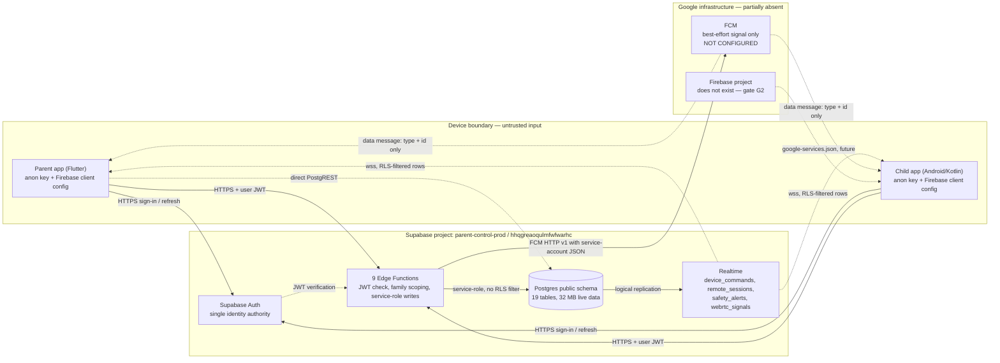

# 02 — Architecture (Stage 1 design record)

Scope: backend-only record of *how the pieces fit*, not an implementation task. Everything below is derived from [01-baseline-inventory.md](01-baseline-inventory.md); nothing here was executed, deployed or applied. Change sequencing and approval gates live in [05-change-plan.md](05-change-plan.md). Policy detail lives in [04-rls-matrix.md](04-rls-matrix.md); secret placement in [06-secrets-and-environments.md](06-secrets-and-environments.md).

Labels used throughout: **VERIFIED** (observed directly), **INFERRED** (consistent with observed evidence, not directly queried), **NOT VERIFIED** (not observable read-only), **PROPOSED** (design only, no code exists).

> **Post-G1 note (2026-10-29, extended 2026-10-30).** G1 was answered after this document was written: policy expressions, RLS flags, grants,
> indexes and trigger definitions are now observed ([evidence/](evidence/), summarised in [04](04-rls-matrix.md) §0a); the
> function and trigger bodies were read on 2026-10-30 (B3b). The `NOT VERIFIED` label now applies only to the 11 unread
> `private` implementations, the 12 unread `public` bodies and `private.record_audit` (PA3). The Edge Function source was
> read in Phase E later on 2026-10-30 ([13](13-edge-function-source-inventory.md), [14](14-edge-function-security-audit.md)).
> The Firebase statements are unchanged.

## 1. Component responsibilities

| Component | Holds | Responsibility | Explicit limits |
| --- | --- | --- | --- |
| Supabase Auth | `auth.users` + identities | **Single identity authority.** Issues the user JWT that every Edge Function call carries. Email/password only; confirm-email on; signups on; anonymous off; manual linking off. | No second identity system. Firebase Auth stays **disabled** unless a written decision in a later stage says otherwise; no user has a Firebase identity today. |
| Postgres (`parent-control-prod`, `hhqgreaoqulmfwfwarhc`) | 19 `public` tables, 32 MB of live data | System of record for every durable fact: family membership, devices, policies, command state, alerts, telemetry, audit. | Free/NANO plan constrains size and connections; no custom server sits in front of it. |
| RLS | Policies on 15 of 19 tables (**VERIFIED** enabled; zero policies on `child_contact_ids`, `device_pairing_tokens`, `pairing_attempts`, `safe_zone_states`) | Last-line defence if a client ever reaches a table directly. Deny-all tables hold pairing secrets and attempt logs. | RLS is on for all 19 and forced for none, so the table owner (and every `SECURITY DEFINER` function) bypasses it. `authenticated` holds a privilege on 14 tables and `anon` on none ([04](04-rls-matrix.md) §0a). RLS is not the primary boundary today, because the Data API is per-table disabled. |
| Data API (PostgREST) | — | Globally enabled, but **every table is individually disabled**. | Clients do not read/write tables directly, so table grants and policies are defence-in-depth for 11 tables — **except** the 4 Realtime-enabled tables, where `postgres_changes` authorises subscribers through the SELECT policies today ([05-change-plan.md](05-change-plan.md) G4, [04-rls-matrix.md](04-rls-matrix.md) §0). |
| Edge Functions (9) | Deno runtime + secrets | The **client-facing surface**: `auth-bootstrap`, `cron`, `device-command`, `device-policy`, `device-register`, `device-telemetry`, `family-admin`, `pairing`, `remote-session`. Must validate the JWT, scope by family in code, and write with service-role. | Required of each function, not yet observed: no wildcard CORS, no trusted client-supplied `family_id`, no secret in a response. Bodies are NOT VERIFIED. |
| Realtime | Logical replication for `device_commands`, `remote_sessions`, `safety_alerts`, `webrtc_signals` only | Fast-path notification that something changed; delivers **row images**, still RLS-filtered. | Not a delivery guarantee. A missed event must be recoverable by refetch. |
| FCM | **No project exists** for this product | Best-effort wake-up signal to Android devices when the app is not connected. | Never authoritative state; never carries sensitive content; not configured today. |
| Parent app (Flutter) | — | Future: family administration, policy editing, command issuing, alert viewing, live view. | Holds only anon key + Firebase client config. Never service-role. |
| Child app (Android/Kotlin) | — | Future: device registration, telemetry/policy sync, command execution and ack, foreground service, safety-zone reporting. | Holds only anon key + Firebase client config. Never service-role, never Admin SDK. |

The important consequence: **the Edge Functions are the API**. Any new client capability is a new function or a new action on an existing function, not a new table grant.

## 2. Trust boundaries and data flow

Two boundaries matter operationally:

1. **Device → Edge Function.** Everything from the device is untrusted, including identifiers. The function derives the caller's identity from the verified JWT and looks the device up server-side rather than trusting a body field. **VERIFIED at the Edge tier by Phase E**: all nine handlers call `db.auth.getUser(token)` or the device-credential check and pass the resulting id explicitly ([14](14-edge-function-security-audit.md) §4). The database functions still take an actor argument, so the SQL tier depends on that derivation holding (F7/E3).
2. **Edge Function → Postgres / FCM.** Privileged. The service-role key and the FCM service account exist only here.

The dotted `direct PostgREST` edge is drawn deliberately: it is reachable in principle (Data API globally on) but every table is disabled, so it should be denied in practice. That is an assumption worth a negative test, not a proof ([05-change-plan.md](05-change-plan.md) G5).

## 3. Source-of-truth decisions

| Domain | Authority | Derived views / signals | Rule |
| --- | --- | --- | --- |
| Family membership | `families`, `family_members` | JWT claims, function-side scope checks | Postgres wins. If a device believes it belongs to family A and the tables say B, the tables are right and the device refreshes. |
| Devices | `devices` (+ `device_pairing_tokens`, `pairing_requests`, `pairing_attempts`) | Function responses, push registration rows | Pairing produces a row; a token alone grants nothing (`child_contact_ids` comment: "never a credential"). |
| Policies | `device_policies`, `safe_zones` | Last-applied policy echoed by the child app | Server copy is authoritative; the child app's applied copy is a cache with a version. |
| Command state | `device_commands` | Realtime row, push signal, ack from device | Only the server-side row is the record; the push is a nudge toward it. |
| Alerts | `safety_alerts`, `safe_zone_states` | Realtime row, push signal | Insert once; notification never creates state. |
| Audit | `audit_logs` (262 rows) | — | Append-only at the trigger level: `audit_logs_append_only` rejects UPDATE/DELETE (**VERIFIED** from [g1-q3](evidence/g1-q3-20261029.json)). |
| Delivery | **FCM** | — | Strictly best-effort signalling. FCM has no authority over command state, membership or policy. |

**Consequences, stated as rules rather than intentions:**

- A push payload is a hint, never a fact. Clients must not render state from a push body.
- On every resume, reconnect or cold start the client calls a **state-fetch** path and replaces local state. Push and Realtime only shorten the time until that fetch happens.
- Because the Data API is per-table disabled, that state-fetch path must be an Edge Function. No function is currently named for it — see §7; it is **PROPOSED**, plausibly folded into `device-policy` / `device-command` rather than a tenth function.

## 4. FCM integration sequence (design only — nothing implemented)

Prerequisites that do not exist yet: a dedicated Firebase project, the real child-app `applicationId`, an Android app registered in that project, and an FCM service account (gate G2 in [05-change-plan.md](05-change-plan.md)). Until then every step below is PROPOSED.

### 4.1 Sequence

| # | Step | Actor | Notes |
| --- | --- | --- | --- |
| 1 | Sign in, obtain user JWT | Client ↔ Supabase Auth | Unchanged; FCM adds no identity. |
| 2 | Register device (`device-register`) | Child app → Edge Function | Device row established server-side. |
| 3 | Obtain FCM registration token | Child app ↔ FCM SDK | Token is device-scoped, can rotate at any time. |
| 4 | Submit token with the user JWT | Child app → Edge Function | Bind token to the **authenticated** device row, never to a body-supplied device id. |
| 5 | Persist token | Edge Function → Postgres | Proposed owner of the token column is `devices`; the current 25 columns are **VERIFIED** to contain no push-token column, so adding one is a G3-style migration. |
| 6 | Server-side send | Edge Function → FCM HTTP v1 | Triggered by command creation, alert insert, pairing event. Idempotent per entity. |
| 7 | Client receives data message | FCM → Child app | Contains `type` + entity `id` only. |
| 8 | Client fetches authenticated state | Client → Edge Function | The payload the client trusts comes from this call, not step 7. |
| 9 | Client acks | Client → Edge Function | Written to the authoritative row; drives retry/stop decisions. |

### 4.2 Token lifecycle

| Case | Detection | Handling |
| --- | --- | --- |
| Token rotated (`onNewToken`) | Client callback | Client re-submits; server replaces the previous token for that device row. Old token may still deliver briefly — harmless, it carries no state. |
| Token invalid / unregistered (`UNREGISTERED`, `INVALID_ARGUMENT`) | FCM send error | Mark the token unusable, stop sending to it, surface "device unreachable" rather than retrying forever. |
| Multiple tokens per device | Several active installs | Keep at most one active token per device row (**PROPOSED**); stale tokens expire. |
| Uninstall | No signal from device | Absence of acks, not a token error. Detected by reconciliation, not by FCM. |

### 4.3 Send discipline

| Concern | Design |
| --- | --- |
| **Deduplication key** | `(entity_type, entity_id)` — for commands the `device_commands` primary key, for alerts the `safety_alerts` id, for remote-session events the `remote_sessions` id. The current column set is **VERIFIED** ([g1-q8](evidence/g1-q8-20261029.json)); no FCM dedupe column exists, so this is a design rule. |
| **Collapse behaviour** | Set the collapse key to the entity id so re-sending the same entity replaces, rather than stacks, the notification. |
| **Retry** | Exponential backoff with jitter, capped attempts, only for transient classes (`UNAVAILABLE`, 429, 5xx). Never retry `UNREGISTERED` / `INVALID_ARGUMENT`. |
| **TTL** | Short for commands (a stale command should arrive via refetch, not eight hours later), longer for alerts. |
| **Payload rule** | **No sensitive content.** No child name, no coordinates, no message text, no policy body, no token, no family id. Only `type` + `id` (+ a coarse priority). Everything else is fetched over an authenticated, family-scoped call. |
| **Failure is normal** | A send is at most a request. Success means "accepted by FCM", which is not "read by the device". |

## 5. Credential handling

| Secret / key | Lives in | Must never appear in |
| --- | --- | --- |
| Service-role key | Edge Function secrets only | Parent/child app, `config.toml`, this repo, chat, CI logs |
| FCM service-account JSON | Edge Function secrets only (env file at deploy time) | Any client bundle, repo, Firebase client config |
| Supabase access token / DB password | Operator's own shell only (never committed) | Repo, docs, chat ([05-change-plan.md](05-change-plan.md) G1) |
| Anon key | Client apps (public by design) | — must never be treated as authorisation; RLS plus disabled tables is what limits it. |
| Firebase client config (`google-services.json`, API key, sender id) | Client apps | — these are identifiers, not credentials for sending. |

The rule that makes this enforceable: **no Firebase Admin SDK in any client**. If a device could send, any device could impersonate the server. See [06-secrets-and-environments.md](06-secrets-and-environments.md) for placement and rotation.

## 6. Failure modes and recovery

| Failure | What breaks | Recovery | Guarantee level |
| --- | --- | --- | --- |
| Function timeout / cold start | One request | Client retries with backoff + jitter; function must be safe to re-run. `cron` and telemetry ingestion are the highest-risk repeat callers. | At-least-once |
| Duplicate command delivery | Device would execute twice | Idempotency on `device_commands`: the command id is the idempotency key; the device keeps the last executed id and ignores repeats. State machine (`pending → delivered → acked/failed`, exact values **PROPOSED**) advances forward only. | Exactly-once *effect* |
| Out-of-order acks | A stale ack overwrites a newer state | Acks carry the command id plus the state they refer to; server keeps the highest state reached and ignores terminal-state regression. Do not order by device clock — device clocks are untrusted. | Monotonic |
| Realtime drop / websocket close | UI stops updating | Reconnect with exponential backoff + jitter, re-subscribe, then **refetch state**; never assume events during the gap were seen. | Eventual |
| Push fails silently | Device does nothing until next resume | Detected only by absence of ack; `cron` reconciles stale commands and alerts, and the app reconciles on every resume. | Eventual, unbounded until resume |
| Device offline for hours | Queue grows | TTL expires stale pushes; the refetch path delivers current truth regardless of whether any push arrived. | Eventual |
| Clock skew | Wrong ordering / wrong "expired" | Server timestamps are authoritative; device time used only for display. | — |
| Partial write (row written, push failed) | State consistent, notification missing | Correct by design: state is written first, push is a hint. Never push-then-write. | — |
| Two devices, one account | Cross-device confusion | State-fetch is scoped to the authenticated device row, not "latest device for user". | — |

The unifying principle: **write state first, notify second, reconcile on resume.** Every failure above degrades to "the client learns later", never to "the client learns something false".

## 7. What exists vs what is proposed

| Item | Status | Evidence / note |
| --- | --- | --- |
| Supabase project, region, plan, live data | VERIFIED | 32 MB, 10 MAU, 8 profiles, 1,773 location events |
| 19 tables in `public` | VERIFIED | [01-baseline-inventory.md](01-baseline-inventory.md) §2 |
| 9 Edge Functions deployed | VERIFIED | Deployed 2–3 days before capture; **internals NOT VERIFIED** |
| Every table API-disabled, Data API globally on | VERIFIED | Dashboard per-table toggles |
| RLS enabled on all tables | VERIFIED | [g1-q1](evidence/g1-q1-20261029.json): 19/19, none forced, owner `postgres` |
| Policy names and commands | VERIFIED | [g1-q2](evidence/g1-q2-20261029.json): expressions included |
| Zero-policy deny-all on 4 tables | VERIFIED (policy list) / INFERRED (effect) | `child_contact_ids`, `device_pairing_tokens`, `pairing_attempts`, `safe_zone_states` |
| Triggers, indexes, grants | VERIFIED | [g1-q3](evidence/g1-q3-20261029.json), [g1-q4](evidence/g1-q4-20261029.json), [g1-q5](evidence/g1-q5-20261029.json), [g1-q6](evidence/g1-q6-20261029.json) |
| Function and trigger bodies (`prosrc`) | VERIFIED for the read set (B3b) | 14 bodies filed in [g1-b3b](evidence/g1-b3b-20261029.json); 11 `private` implementations, 12 `public` bodies and `private.record_audit` remain unread (PA3) |
| Realtime on 4 tables | VERIFIED | `device_commands`, `remote_sessions`, `safety_alerts`, `webrtc_signals` |
| Supabase Auth as sole identity authority | VERIFIED (current state) | Email only, confirm-email on, anonymous off, manual linking off |
| Firebase Auth disabled | VERIFIED (current state) | No Firebase project for this product; no user has a Firebase identity |
| FCM configured | **DOES NOT EXIST** | No product Firebase project; only an unrelated FlutterFlow demo; CLI on a different Google account (G2) |
| Device-token storage for FCM | PROPOSED | Would attach to `devices`; the current 25 columns contain no token column (Q8) |
| Edge Function → FCM send path | PROPOSED | Needs service-account secret + HTTP v1 call; nothing written |
| Dedicated state-fetch function | PROPOSED | No function by that name among the 9; likely folded into `device-policy` / `device-command` |
| Command state machine values | PROPOSED | `device_commands` has 15 columns, contents NOT VERIFIED |
| Idempotency / ack ordering rules | PROPOSED | Depends on the real column set |
| Retry + backoff in clients and functions | PROPOSED | Not observable from outside |
| Parent app, child app | DO NOT EXIST | Stage 2+; toolchain present only (`flutter` 3.38.8, JDK 17) |
| `supabase/` migrations baseline | DOES NOT EXIST | Migrations page empty; gate G3 |

## 8. What this record does not claim

- No Firebase project was created, no FCM credential exists, and no send has been attempted.
- Policy expressions and trigger definitions were read in the G1 run, but function and trigger **bodies** (`prosrc`) were not, so any statement about *how* a function enforces family scope is still INFERRED from its signature, grants and the calling policy, not observed.
- The Data-API posture is now backed by catalogue evidence (no `anon` grant, no client `EXECUTE`); the negative request that would confirm it end-to-end is still blocked on G5 (test identities) rather than on G1.
- No new infrastructure is proposed: no Firebase Auth, no Redis, no custom server, no paid tier. Stage 1 ends at design plus gates.

## 9. Addendum — topology stated once, and one 2026-10-30 change (2026-11-02, S2-DOC-02)

Append-only. Nothing in §1–§8 is rewritten: those rows describe the **production** project as read on 2026-10-29/30 and
remain the authoritative baseline for production state.

**The service topology, stated plainly so it cannot be re-asked:**

| # | Concern | Authority | Verified source |
| --- | --- | --- | --- |
| 1 | Identity / authentication | **Supabase Auth** (`auth.users` + identities) — the single identity authority. It issues the user JWT every Edge Function call carries. | §2 (`:18`), [00-status-register.md](00-status-register.md) P-series, all 9 handlers call `db.auth.getUser(token)` per [13-edge-function-source-inventory.md](13-edge-function-source-inventory.md) |
| 2 | Primary database | **Supabase Postgres** (production `hhqgreaoqulmfwfwarhc`; staging `dzonzgngwxclhfnvxtvu`) | [01-baseline-inventory.md](01-baseline-inventory.md), [03-data-model.md](03-data-model.md) |
| 3 | Backend API | **Supabase Edge Functions** (9 functions) | [13-edge-function-source-inventory.md](13-edge-function-source-inventory.md) |
| 4 | Live updates | **Supabase Realtime** on 4 tables | §5 row `:171` |
| 5 | Push transport | **Firebase Cloud Messaging, best-effort signal only** — no authority over state, never carries sensitive content, `NOT CONFIGURED` | §2 (`:24`), §3 diagram (`:47`), §4 (`:92`), §5 (`:84`), §7 (`:174`) |
| 6 | Firebase Auth | **Not in the approved architecture.** Stays disabled; no user holds a Firebase identity. | §2 (`:18`), §7 (`:173`) |
| 7 | Firestore / Realtime Database / Cloud Functions / Hosting / Analytics | **Not assumed, not used, not enabled.** | §8 (`:189`) |

**One factual change to the surface of this record.** `:173`, `:174` and `:186` each say no Firebase project exists for
this product. That was true when written. On 2026-10-30 an **empty** Firebase project shell was created during Stage 2:
display name `haven-staging`, project ID `haven-staging-46822`, project number `381273275501`, Spark plan, Analytics
off, **zero registered apps, zero credentials, no FCM configuration, no service account**. Evidence:
[S2-CREATE-01](../stage2/evidence/S2-CREATE-01-new-projects.md) §3, re-confirmed read-only in
[S2-INSP-03](../stage2/evidence/S2-INSP-03-read-only-reconfirmation.md) §2.

Consequences, bounded deliberately:

- **Rows 1–7 above do not change.** A shell with no app and no credential authenticates nobody, stores nothing and
  sends nothing. FCM remains `NOT CONFIGURED` (`:174` still holds in substance) and Firebase Auth remains absent from
  the architecture.
- What *does* change is the wording "no Firebase project exists for this product": a project now exists **for staging**,
  empty, and its creation was an executed action that **exceeded the Stage 2 no-Firebase-action prohibition** and is
  recorded as `AWAITING RETROSPECTIVE RATIFICATION` — see
  [approval-package-v2 §2](../stage2/approval-package-v2-ratification-and-forward.md) and risk **R-36** in
  [stage2/04 §1](../stage2/04-risks-rollback-approvals.md).
- Production Firebase state is unchanged: the project `parent-control-prod` is a Supabase project and there is still no
  production Firebase app, credential or FCM path for this product.
- Nothing in this addendum authorises Firebase app registration, FCM, a service account, or any credential crossing
  between the two Google identities (`spg7753@gmail.com` owns Supabase; `shiwa2172000@gmail.com` owns the Firebase
  shell) — that boundary and the A12 gate are Stage 2/Stage 3 owner decisions.
