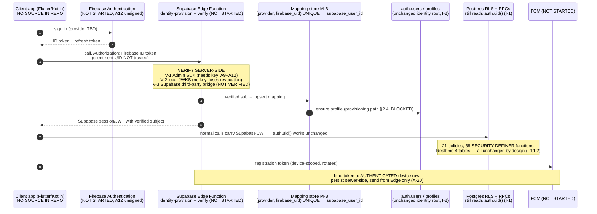

# S2-A1 — Identity-Model Migration Audit: Supabase Auth → Firebase Authentication + FCM

**Author:** Subagent A1 (Architecture & Authentication Auditor)
**Mode:** OFFLINE, REPOSITORY-ONLY. No browser, no dashboard, no Supabase console, no Firebase console, no CLI,
no REST/API call, no database connection, no SQL execution, no network request of any kind.
**Date of audit:** 2026-11-03 (file mtimes observed: Stage 1 capture 2026-10-29/30, Stage 2 artefacts 2026-11-02/03)
**Object of the audit:** a *proposed* owner direction — move authentication and push to **Firebase Authentication +
Firebase Cloud Messaging**, keep **Supabase** for database, RLS, SQL functions, triggers and Edge Functions, bridged by
a **Firebase UID → Supabase profile** mapping in which **every protected Edge Function validates the Firebase ID token
server-side and never trusts a client-sent UID**.

> **This document authorises nothing.** It is an audit, not an approval, not a signature, and not a plan of work.
> Gates **A2′(a), A2′(b), A3, A9 and A12 are `UNSIGNED`**; **A5** is `APPROVED — NOT EXECUTABLE`
> ([README.md](README.md):86-87); **A1** is `INOPERATIVE` ([README.md](README.md):84). The owner's architecture
> direction is a *design input* to this audit and **does not override any gate**; where the direction requires a
> console change, a credential, a DDL statement or a Firebase product enablement, the item below is recorded as
> `BLOCKED — APPROVAL REQUIRED` and stays blocked until a signed fence exists.

**Status vocabulary used (exhaustive):** `NOT STARTED`, `PLANNED`, `BLOCKED — APPROVAL REQUIRED`, `IN PROGRESS`,
`CONFIGURED`, `VERIFIED`, `FAILED`, `NOT APPLICABLE`. `VERIFIED` and `CONFIGURED` are used **only** where a cited
observation exists in this repository. Anything I could not observe is labelled `NOT VERIFIED` as a *finding of fact*
(not as a setup status) or carries no status at all.

**PII rule applied:** no email address, account name, user row, coordinate, key, token, JWT or secret value is
reproduced anywhere in this document. Where a file contains one, I cite **file + location + type only**.

---

## 0. Method, source set, and two negative findings I confirmed myself

### 0.1 What I read (all paths absolute under `D:\control`)

`docs/stage2/00-stage2-execution-plan.md`, `docs/stage2/README.md`, `docs/stage2/01-staging-project-proposal.md`,
`docs/stage2/04-risks-rollback-approvals.md`, `docs/stage2/approval-package-v2-ratification-and-forward.md`,
`docs/stage2/S2-EXEC-04-a3-precondition-matrix.md`, `docs/stage2/S2-REVIEW-03-independent-audit.md`,
`docs/stage2/patches/S2-P01-e2-f8.sql`, `S2-P02-e3-actor-binding.sql`, `S2-P03-e4-session-invariant.sql`,
`docs/stage2/evidence/S2-INSP-02-firebase-console.md`, `docs/stage2/evidence/S2-INSP-03-read-only-reconfirmation.md`,
`docs/stage1/02-architecture.md`, `docs/stage1/04-rls-matrix.md`, `docs/stage1/05-change-plan.md`,
`docs/stage1/06-secrets-and-environments.md`, `docs/stage1/13-edge-function-source-inventory.md`,
`docs/stage1/14-edge-function-security-audit.md`, `docs/stage1/16-phase-e-findings.md`,
`docs/stage1/reports/stage1-final.md`, `docs/stage1/evidence/functions-and-triggers.md`,
`docs/stage1/evidence/edge-functions/capture-20261030.json`, `docs/stage1/evidence/g1-run-manifest-20261029.md`,
`docs/stage1/evidence/g1-q1/q2/q3/q3b/q5/q6/q7/q8-20261029.json`, `docs/stage1/evidence/g1-b3b-20261029.json`,
`firebase/SETUP-CHECKLIST.md`, `supabase/config.toml`, `.env.example`.

### 0.2 What I ran (read-only, local)

Directory listings, `grep`, `find`, `wc`, and Python parsing of the `g1-*.json` evidence files to count and select
records. No command connected to anything, and no command read production.

**Production was never touched.** Every statement I make about the production project
(`parent-control-prod`) is a restatement of the in-repo 2026-10-29/30 read-only capture
(`g1-*` / `g1-b3b`, read-only proven by `transaction_read_only = on` in
[docs/stage1/evidence/g1-b3b-20261029.json](../stage1/evidence/g1-b3b-20261029.json) and
[g1-run-manifest-20261029.md](../stage1/evidence/g1-run-manifest-20261029.md)). Under the staging-only absolute
(C2b/R-43) production is out of reach for this audit, exactly as it is for A1 — [README.md](README.md):84.

### 0.3 Negative finding 1 — there is no application source in this repository

I confirmed this myself:

```
find . -type f \( -name '*.dart' -o -name '*.kt' -o -name '*.java' -o -name '*.swift' \
     -o -name 'pubspec.yaml' -o -name 'build.gradle*' \)      →  no output
```

**Consequence:** there is **no Flutter or Kotlin source** in this repository. Therefore the client side of every
authenticator statement below — sign-in, token storage, refresh, sign-out, FCM registration-token handling, Firebase
SDK initialisation — is **`NOT VERIFIED` as an implementation** and can only be described from design records
(`docs/stage1/02-architecture.md` §4, `firebase/SETUP-CHECKLIST.md`). Nothing in this audit can attest to what the
shipped apps actually do. This is also why `S2-REVIEW-03` records "Firebase SDK inside the shipped APKs
`NOT VERIFIED`" ([S2-REVIEW-03-independent-audit.md](S2-REVIEW-03-independent-audit.md) §G, row 1c).

### 0.4 Negative finding 2 — `verify-firebase-token` does not exist here

`grep -ri "verify-firebase-token"` over the repository returns **nothing**, as does any search for a Firebase token
verification routine, an Admin SDK import, or a JWKS/OIDC verification path. **`verify-firebase-token` is therefore a
proposed, unevidenced component — not current state.** All 9 Edge Functions are catalogued from dashboard-captured
source and none of them mentions Firebase
([docs/stage1/13-edge-function-source-inventory.md](../stage1/13-edge-function-source-inventory.md); source tree
`supabase/functions/` is `VERIFIED absent`, item I1).

---

## 1. Current-state auth inventory

Every row is one identity/authentication assumption that today's designs and patches rely on. Class is
**Verified** (a cited observation exists), **Inferred** (derived from cited observations, not stated), **Missing
evidence** (the repository has no record that could settle it), or **Unverified** (a record exists but explicitly
declines to confirm it).

| # | Assumption | Source (file:line / JSON key) | Class | Setup status |
|---|---|---|---|---|
| A-01 | Supabase Auth (`auth.users` + identities) is the **single identity authority**; email/password only, confirm-email on, signups on, anonymous off, manual linking off | [docs/stage1/02-architecture.md](../stage1/02-architecture.md):18, :200, :172 | Verified (documentary + captured) | `VERIFIED` as a documented rule; the underlying *settings* were captured from the dashboard on 2026-10-29 |
| A-02 | `auth.users` exists as an identity root and is **pre-created by Supabase**, not by this project's schema | [g1-q5-20261029.json](../stage1/evidence/g1-q5-20261029.json) `profiles_id_fkey` = `FOREIGN KEY (id) REFERENCES auth.users(id) ON DELETE CASCADE`, `validated:true`; [S2-EXEC-04-a3-precondition-matrix.md](S2-EXEC-04-a3-precondition-matrix.md) §3.1 ("its FK to `auth.users` is satisfiable **only** because Supabase pre-creates that table") | Verified | `VERIFIED` (capture) |
| A-03 | 21 RLS policies exist, all with `roles = "authenticated"` | [g1-q2-20261029.json](../stage1/evidence/g1-q2-20261029.json) (21 records, keys `tablename/policyname/cmd/roles/qual/with_check`) | Verified | `VERIFIED` (captured as predicates, **not** as DDL) |
| A-04 | **17 of 21** policies delegate their authorisation to `private.is_family_parent` / `private.is_family_member` / `private.shares_active_family`, and those helpers anchor on `auth.uid()` | g1-q2 `qual`/`with_check` strings; [docs/stage1/04-rls-matrix.md](../stage1/04-rls-matrix.md):206-207, :361 ("every one anchors on `auth.uid()`") | Verified | `VERIFIED` (capture) |
| A-05 | Exactly **4 policies depend only on `auth.uid()`**: `families_update_owner`, `profiles_update_self`, `webrtc_signals_insert_participant`, `webrtc_signals_select_participant` | g1-q2 (cross-checked against the 21 names); [docs/stage1/04-rls-matrix.md](../stage1/04-rls-matrix.md):116, :136, :158-159 | Verified | `VERIFIED` (capture) |
| A-06 | The SQL helpers `auth.uid()`, `auth.email()`, `auth.role()`, `auth.jwt()` are owned by `supabase_auth_admin`, are **not** `SECURITY DEFINER`, and are `stable` | [g1-q7-20261029.json](../stage1/evidence/g1-q7-20261029.json) (18 rows: keys `function_name/security_definer/volatility/settings/acl/owner`) | Verified | `VERIFIED` (capture) |
| A-07 | Profile provisioning is a **trigger on `auth.users`**: `CREATE TRIGGER on_auth_user_created AFTER INSERT ON auth.users FOR EACH ROW EXECUTE FUNCTION private.handle_new_user()`, enabled flag `O`, `security_definer:true`, `search_path=public, private, pg_temp` | [g1-q3b-20261029.json](../stage1/evidence/g1-q3b-20261029.json) (single record, verbatim) | Verified | `VERIFIED` (capture) — **in production only**; see §5 for staging |
| A-08 | `private.handle_new_user()` derives `display_name` from `new.raw_user_meta_data ->> 'display_name'`, else the email local-part, else `'User'` (60 chars), then `insert into public.profiles (id, role, display_name) values (new.id,'unset',v_name) on conflict (id) do nothing` | [g1-b3b-20261029.json](../stage1/evidence/g1-b3b-20261029.json) `bodies[]` entry `handle_new_user` | Verified | `VERIFIED` (capture) |
| A-09 | **Edge-tier** JWT validation is server-side and delegated: the handler extracts `Bearer` with `/^Bearer\s+(\S+)$/i` and min length 20, then calls `db.auth.getUser(token)`; signature, expiry **and revocation** are decided by the Supabase Auth server; a network failure becomes `401` (fails closed) | [docs/stage1/14-edge-function-security-audit.md](../stage1/14-edge-function-security-audit.md):59-64 (anchors `_shared/auth.ts:68-75`, `:92`, `:93-104`) | Verified (source captured from the dashboard Monaco editor, not from a repo file) | `VERIFIED` (capture) |
| A-10 | **All 9 Edge Functions use the service-role key, therefore RLS never applies to them**; `auth.uid()` is `NULL` for every live caller | [docs/stage1/14-edge-function-security-audit.md](../stage1/14-edge-function-security-audit.md) Check 12 (:243-245); [docs/stage2/patches/S2-P02-e3-actor-binding.sql](patches/S2-P02-e3-actor-binding.sql) header ("all current callers use service_role, where auth.uid() is NULL, so actor_mismatch is INERT today") | Verified | `VERIFIED` (capture) |
| A-11 | Authorisation today takes the actor from a **function argument** (`p_actor_user_id`, `p_parent_user_id`, `p_owner`, `p_child_user_id`), not from `auth.uid()`; five of 14 Postgres functions take **no actor argument at all** | [docs/stage1/04-rls-matrix.md](../stage1/04-rls-matrix.md):310, :356; [docs/stage1/14-edge-function-security-audit.md](../stage1/14-edge-function-security-audit.md) Check 3 | Verified | `VERIFIED` (F7 Edge `CLOSED` / SQL `OPEN`) |
| A-12 | Three `private` trigger bodies branch on the **JWT role claim** being `service_role` (`current_user in ('service_role','postgres','supabase_auth_admin','...') or coalesce(current_setting('request.jwt.claim.role', true),'')='service_role'`) | [g1-b3b-20261029.json](../stage1/evidence/g1-b3b-20261029.json) `bodies[]` (trigger guard functions) | Verified | `VERIFIED` (capture) — **note this is a second, claim-based identity channel** |
| A-13 | RLS is `ENABLED` on all 19 tables but **`FORCED` on none**; owner `postgres`; `authenticated` is **absent** from the ACL of `child_contact_ids`, `device_pairing_tokens`, `devices`, `pairing_attempts`, `safe_zone_states` | [g1-q1-20261029.json](../stage1/evidence/g1-q1-20261029.json) (19 rows, keys `rls_enabled/rls_forced/owner/table_acl`) | Verified | `VERIFIED` (capture) |
| A-14 | PostgREST/Data API is **globally enabled but exposes 0 of 19 tables and 0 of 38 functions**; exposed schemas `public` + `extensions`; `auto_expose_new_tables` off | [g1-b3b-20261029.json](../stage1/evidence/g1-b3b-20261029.json) `data_api_exposure`; [docs/stage1/evidence/functions-and-triggers.md](../stage1/evidence/functions-and-triggers.md):114 | Verified | `VERIFIED` (capture) |
| A-15 | Roles: `anon`, `authenticated`, `service_role` are members of `authenticator` **and** of `postgres` (admin_option), and of `supabase_realtime_admin`; **no login role inherits `service_role`** | [g1-q6-20261029.json](../stage1/evidence/g1-q6-20261029.json) `role_memberships` (24 rows); pre-check reused at [S2-P01-e2-f8.sql](patches/S2-P01-e2-f8.sql) line "pre-check 0.7 … Expect 0 rows" | Verified | `VERIFIED` (capture) |
| A-16 | `authenticator` is `rolsuper:false`, `rolbypassrls:false`, `session_preload_libraries = supautils, safeupdate`, eight statement/idle timeouts | [g1-b3b-20261029.json](../stage1/evidence/g1-b3b-20261029.json) `authenticator_role_config` | Verified | `VERIFIED` (capture) |
| A-17 | Session/JWT settings: access-token expiry **3600 s**, refresh-token rotation **on**, reuse interval **10 s**, single-session-per-user **off** (Pro-only), time-box/inactivity **0/0** (Pro-only), SSL enforcement **NOT CAPTURED** | [docs/stage1/evidence/functions-and-triggers.md](../stage1/evidence/functions-and-triggers.md):103-108 | Verified (except SSL) | `VERIFIED` for the rows with values; SSL = `NOT VERIFIED` |
| A-18 | Firebase Auth is **disabled and not in the approved architecture**; no user has a Firebase identity; Firestore/RTDB/Cloud Functions/Hosting/Analytics are "not assumed, not used, not enabled" | [docs/stage1/02-architecture.md](../stage1/02-architecture.md):18, :173, :205, §9 rows 1 and 5-7; [docs/stage2/01-staging-project-proposal.md](01-staging-project-proposal.md) §6/§7 row 6; [docs/stage2/approval-package-v2-ratification-and-forward.md](approval-package-v2-ratification-and-forward.md) §1.7; [firebase/SETUP-CHECKLIST.md](../../firebase/SETUP-CHECKLIST.md) D4 | Verified | `NOT APPLICABLE` as an enabled product; `NOT STARTED` as an identity system |
| A-19 | The Firebase **staging shell** (`haven-staging` / `haven-staging-46822`, project number recorded in evidence) has **zero registered apps and no Firebase product enabled**: the console left navigation shows only *Project Overview* and *Settings* | [docs/stage2/evidence/S2-INSP-03-read-only-reconfirmation.md](evidence/S2-INSP-03-read-only-reconfirmation.md) §2-§3 ("There are no apps in your project"); plan tier Spark `NOT VERIFIED` on that pass | Verified | `NOT STARTED` (auth provider, Android app, FCM, credentials) |
| A-20 | FCM is **not configured**; there is **no push-token column anywhere** and no `devices` Firebase column | [docs/stage1/02-architecture.md](../stage1/02-architecture.md):24, :104, :174-175; [firebase/SETUP-CHECKLIST.md](../../firebase/SETUP-CHECKLIST.md) §5; my own scan of [g1-q8-20261029.json](../stage1/evidence/g1-q8-20261029.json) (183 columns; **0** matches for `firebase`, `push`, `provider`, `external`, `uid`) | Verified | `NOT STARTED` (transport); the 25-column `devices` set is `VERIFIED` token-free. (The source docs' own wording for this row is "NOT CONFIGURED"/"DOES NOT EXIST" — quoted, not used as a status here.) |
| A-21 | A **second principal already exists**: device-credential auth (`x-device-id` + `x-device-secret`, SHA-256 + constant-time compare) authorises `device-telemetry` and friends with **no user JWT at all**; `auth-bootstrap` additionally gates on a **verified email** (`email_confirmed_at`); `cron` uses a shared secret | [docs/stage1/evidence/edge-functions/capture-20261030.json](../stage1/evidence/edge-functions/capture-20261030.json) per-function `auth_model` + anchors; [docs/stage1/13-edge-function-source-inventory.md](../stage1/13-edge-function-source-inventory.md) | Verified | `VERIFIED` (capture) |
| A-22 | **Realtime authorises subscribers through the SELECT policies**, so those predicates are load-bearing today on 4 tables (`device_commands`, `remote_sessions`, `safety_alerts`, `webrtc_signals`) even with PostgREST closed | [docs/stage1/04-rls-matrix.md](../stage1/04-rls-matrix.md):78, :188 | Verified | `VERIFIED` (documentary + captured `postgres_changes` list) |
| A-23 | Supabase **third-party Firebase** support is a *configuration knob* (`[auth.third_party.firebase]`, `enabled = false`, `project_id` commented out); `[auth.hook.custom_access_token]` and `[auth.hook.before_user_created]` are commented out | [supabase/config.toml](../../supabase/config.toml):343-345, :270-286 | Verified **as a local file only** | `NOT VERIFIED` for any project — this file is a local template that **drifts from production** ([docs/stage1/13-edge-function-source-inventory.md](../stage1/13-edge-function-source-inventory.md) §1, item I5). It is **not** evidence that the knob is available, enabled or supported on the staging plan |
| A-24 | **Implied-only:** "one `profiles` row per identity, whose primary key *is* the identity" (i.e. `profiles.id = auth.users.id = auth.uid()`). Nowhere stated as a rule; it is the composition of `profiles_id_fkey` (A-02), `profiles.id uuid NOT NULL` with **no default** ([g1-q8](../stage1/evidence/g1-q8-20261029.json)), the trigger inserting `new.id` (A-07/A-08) and `id = auth.uid()` predicates (A-05) | Derived | **Inferred** | n/a |
| A-25 | **Implied-only:** "the authenticated principal is always a Supabase JWT subject." The migration proposal contradicts this; A-21 already shows it is false in part (device principals) and A-12 shows a claim-based channel | Derived from A-12, A-21 | **Inferred** | n/a |
| A-26 | **Implied-only:** "sign-up happens through Supabase Auth so `handle_new_user` always fires." No in-repo record proves which app path creates users, because there is no app source (§0.3) | — | **Missing evidence** | n/a |
| A-27 | **Implied-only:** "`auth.users` is empty on staging." The delegation states 0 tables / schema never loaded; the *user count* is separately contradicted: staging Auth page printed `Total: 10 users (estimated)` over an empty grid while production printed an exact aggregate (FX-18) | [README.md](README.md):135; [S2-INSP-03-read-only-reconfirmation.md](evidence/S2-INSP-03-read-only-reconfirmation.md) §3; FX-18 row in [00-stage2-execution-plan.md](00-stage2-execution-plan.md) | **Unverified** | n/a — the count is deliberately deferred to the first statement of the A3 window ([approval-package-v2…](approval-package-v2-ratification-and-forward.md) §3.4) |
| A-28 | **Implied-only:** "9 Edge Functions are the protected surface, and their source is knowable." Source was **captured from the dashboard**, not version-controlled; `supabase/functions/` is absent | [docs/stage1/13-edge-function-source-inventory.md](../stage1/13-edge-function-source-inventory.md) I1 (`VERIFIED absent`), I4 (env values `NOT VERIFIED`) | **Verified absence** | n/a |

**Headline of this section.** The current design is a **two-tier identity model**: Supabase Auth for the *user* tier
(A-01…A-08) and **device credentials** for the *device* tier (A-21), glued to Postgres by `auth.uid()` at the policy
layer (A-04/A-05) and **bypassed entirely** at the Edge layer (A-10). The proposed Firebase direction does not remove
any of that glue; it replaces only the *issuer* of the user tier while the authorisation layer keeps reading
`auth.uid()`. **That is the whole difficulty**, and it is why §2 exists.

---

## 2. Target state: the Firebase-UID → Supabase-profile mapping

Nothing in this section is authorised. Every DDL item is `BLOCKED — APPROVAL REQUIRED` (A2′/A3/A5 chain), every
credential item is `BLOCKED — APPROVAL REQUIRED` (A9/A12), and every Firebase console item is
`BLOCKED — APPROVAL REQUIRED` (A12, which is unsigned; the amended wording permits **project creation only** —
[README.md](README.md):18, :97).

### 2.1 Invariants the mapping must preserve

| ID | Invariant | Why it is load-bearing | Evidence |
|---|---|---|---|
| I-1 | Every authorising SQL predicate continues to resolve the caller through **`auth.uid()`** (or a helper that does) | 21/21 policies are `authenticated`-scoped; 17 delegate to helpers that anchor on `auth.uid()`; 4 anchor on it directly | A-04, A-05 |
| I-2 | Every identity still has **exactly one `auth.users` row**, and `profiles.id` equals it | `profiles_id_fkey … REFERENCES auth.users(id)` is the **only** auth FK in 137 constraints; 19 tables FK into `profiles` | A-02, A-24 |
| I-3 | A Firebase UID maps to **at most one** identity row, and each identity row maps to **at most one** Firebase UID | The client-sent UID must never be trusted (§3); a many-to-one mapping re-opens exactly the actor-confusion defect F7/E3 already documents | A-11; [S2-P02-e3-actor-binding.sql](patches/S2-P02-e3-actor-binding.sql) |
| I-4 | Deleting an identity must not orphan rows that are `NOT NULL`-referenced | `families.owner_id` is `NOT NULL`; `devices.child_user_id`-style columns exist across the fan-in | A-02, [g1-q8](../stage1/evidence/g1-q8-20261029.json) |

### 2.2 Where the mapping lives

The repository contains **no Firebase-UID column, table or constraint** of any kind (§A-20 my own scan). So this is a
choice to be made, not a discovery. Three candidate placements, judged only against in-repo evidence:

| Option | Shape | Pros | Cons, evidenced | Verdict |
|---|---|---|---|---|
| **M-A** — a column on `profiles` (e.g. a `text` external-uid column plus a unique index) | Additive `ALTER TABLE public.profiles ADD COLUMN …` + `CREATE UNIQUE INDEX` | Smallest surface; keeps `profiles.id` as the identity key (I-2 intact); C4-compatible (additive patch) | Mixes an *auth* concern into a *domain* table that 19 tables reference and that clients can `UPDATE` under `profiles_update_self`; a column on `profiles` inherits whatever column-level grants exist (`authenticated` has SELECT only — [g1-q6](../stage1/evidence/g1-q6-20261029.json) `table_grants`); harder to extend to a second provider | Viable fallback |
| **M-B (recommended shape)** — a **separate mapping table** (identity-bridge), holding `(external provider, external uid, supabase user id, created/confirmed timestamps)` with a **unique constraint on `(provider, external uid)`** and `ON DELETE CASCADE` on the `auth.users` FK | New table + new index, no change to existing tables | Preserves I-2 unchanged; mirrors the `auth.users`→`profiles` pattern already in use (A-07/A-08); extensible to more providers; keeps `RLS` posture consistent with "RLS enabled, no exposure" (A-13/A-14); satisfies C4 (purely additive) | Needs the *same* provisioning path as M-A; adds a 20th table to an artefact that is already `NOT LOAD-READY` (§5); needs its own RLS posture decision — note that **RLS enabled with zero policies is deny-all**, which is the safe default here ([S2-EXEC-04-a3-precondition-matrix.md](S2-EXEC-04-a3-precondition-matrix.md) §3.1) | **Recommended** |
| **M-C** — no Supabase-side mapping; treat the Firebase UID as the *only* key and re-key `profiles.id` to it | Replace the identity root | Destroys I-2: `profiles_id_fkey` must be dropped and **19 inbound FKs re-authored**, plus all 21 policy predicates and the `auth.uid()` glue (A-02, A-04, A-05) | Rejected: it is a schema rewrite, not a migration, and the repository's own app-preservation part ([docs/stage2/parts/H-app-preservation.md](parts/H-app-preservation.md)) treats even a `REVOKE` as a LOW-risk change requiring impact review | **Rejected** |

**Status for all three:** `NOT STARTED`. No DDL for any of them exists in `docs/stage2/patches/` (which holds only
S2-P01/P02/P03 for E2/F8, E3, E4).

### 2.3 Uniqueness and how it is enforced

Required, by I-1/I-3:

1. A **unique index on `(provider, external_uid)`** in the chosen placement. Precedent in-repo for exactly this style
   of guard: the partial unique index in [S2-P03-e4-session-invariant.sql](patches/S2-P03-e4-session-invariant.sql)
   (`remote_sessions_one_live_per_device … where status in ('requested','accepted','active')`).
2. **`upsert`-style idempotency** at the provisioning call site, matching the existing
   `on conflict (id) do nothing` pattern in `private.handle_new_user()` (A-08) — so a replayed provisioning cannot
   create two profiles.
3. A decision on **email as a merge key**. The repository's posture today is `enable_manual_linking = false`
   ([supabase/config.toml](../../supabase/config.toml):180) — **but that is a local file, so the production/staging
   value is `NOT VERIFIED`** (A-23). If two Firebase accounts carry the same email, nothing in the current schema
   prevents two Supabase profiles for one human, or two claims on one profile. **Missing evidence.**
4. Enforcement is **only real once the object exists**. The G3 artefact emits **0 policies and 0 triggers** (§5), so
   today there is no loaded constraint anywhere to lean on.

### 2.4 Provisioning path — the hard part

The scenario is the normal one: a user signs in with Firebase Auth (or a Firestore-shaped client flow exists), so a
Firebase UID exists, but **no `auth.users` row and no `profiles` row exist**. Two facts make this difficult:

* **F-1.** `profiles.id` **cannot** be satisfied by a Firebase UID: it is a `uuid NOT NULL` **with no default** and an
  FK to `auth.users(id)` (A-02, A-24). A Firebase UID is not a UUID and is not an `auth.users` row.
* **F-2.** Creating an `auth.users` row from outside Supabase Auth requires an **admin-level write to the `auth`
  schema**, i.e. the service-role key (the only tier that can bypass RLS and own that schema — A-10, A-13) — or the
  Auth admin API. **There is no in-repo evidence that such a call exists or is permitted.** All 9 Edge Functions are
  catalogued and none writes `auth.users` ([docs/stage1/13-edge-function-source-inventory.md](../stage1/13-edge-function-source-inventory.md));
  one capture anchor records a **direct `remote_sessions` insert that bypasses the RPC** (E4), which is the repo's only
  documented example of a "privileged write outside the RPC layer" and it is a *defect*, not a precedent to copy
  ([docs/stage1/evidence/edge-functions/capture-20261030.json](../stage1/evidence/edge-functions/capture-20261030.json)).

Therefore the provisioning chain **must** be, in order:

```
Firebase sign-in → client holds ID token
  → Edge Function (new, name proposed as "identity-provision")
      1. verify ID token SERVER-SIDE (§3)      ← never trust a client-sent UID
      2. derive Firebase UID from the VERIFIED payload only
      3. upsert mapping (provider, uid) → supabase_user_id
      4. if no supabase_user_id: create/fetch the auth.users identity,
         then create the profiles row          ← requires a decision, see O-4 §8
      5. return a Supabase session/JWT whose subject is that identity
  → every subsequent protected call carries BOTH:
      a Supabase JWT (for auth.uid() at the SQL tier) and the Firebase ID token (for revocation checks)
```

Status of each element: step 1 `NOT STARTED`; steps 2–3 `PLANNED` (design only, this file); step 4
`BLOCKED — APPROVAL REQUIRED` (needs an owner decision on identity creation + a Supabase admin capability that is
`NOT VERIFIED` in this repo); step 5 `PLANNED`.

**Recommendation R-1 (design only, no authority):** prefer the shape where `auth.users` remains the identity root and
Firebase is an *external* provider bridged by M-B, because that keeps invariants I-1, I-2 and I-4 intact with an
additive-only patch (C4). Any shape that removes `auth.users` from the chain is a schema rewrite (M-C) and contradicts
the app-preservation posture in [docs/stage2/parts/H-app-preservation.md](parts/H-app-preservation.md).

### 2.5 What happens to `on_auth_user_created` / `private.handle_new_user()`

Today (production capture): enabled trigger, `AFTER INSERT ON auth.users`, `SECURITY DEFINER`, `search_path=public,
private, pg_temp`, inserting a `profiles` row with `role='unset'` and a derived display name (A-07, A-08).

Under the Firebase direction this design is **stranded in four distinct ways**:

| Case | Condition | Consequence |
|---|---|---|
| S-1 | Firebase-only sign-ups; `auth.users` never written | The trigger **never fires**; no profile is ever created; every `id = auth.uid()` predicate has nothing to match → silent deny-all. |
| S-2 | Provisioning writes `auth.users` via the admin path (F-2, unapproved) | The trigger **does** fire and auto-creates a profile with `role='unset'` and a display name derived from `raw_user_meta_data`/email. **The provisioning function must therefore NOT also insert into `profiles`**, or it double-provisions; the existing `on conflict (id) do nothing` (A-08) is what makes that safe today. |
| S-3 | `raw_user_meta_data ->> 'display_name'` is populated by Supabase sign-up, not by Firebase | With Firebase, metadata arrives from wherever the bridge puts it, so the display-name derivation chain (A-08) degrades to the email local-part or `'User'`. Cosmetic, but it is an **unstated dependency on Supabase sign-up**. |
| S-4 | The artefact is `NOT LOAD-READY`: **0 triggers emitted** (§5) | On staging the trigger does not exist at all. Any Firebase design that assumes it exists is designing against an object that has never been created in the only project this programme is allowed to touch (C2b/R-43). |

**Status:** `NOT STARTED`, with an explicit note that its *fate* is an open owner decision (O-5 in §8), not a technical
determinism.

### 2.6 Account deletion and cascade

* The **only** auth-rooted cascade in the captured 137 constraints is `profiles_id_fkey … ON DELETE CASCADE` (A-02).
* Fan-in from `profiles` is **19 inbound FKs**, then `families` 12, `devices` 9, and 1 each from `user`s,
  `safe_zones`, `remote_sessions`, `device_pairing_tokens` ([g1-q5](../stage1/evidence/g1-q5-20261029.json)).
* Deleting the `auth.users` row therefore deletes the `profiles` row and, transitively, whatever cascades from those
  19 references — **but the delete only happens if the bridge propagates a Firebase account deletion**, which is a new
  component that does not exist (`NOT STARTED`).
* `families.owner_id` is `NOT NULL` (A-04 domain evidence; [g1-q8](../stage1/evidence/g1-q8-20261029.json)) and the
  live owner policy is `owner_id = auth.uid()` with **no transfer path** (`WITH CHECK (owner_id = auth.uid())`,
  `owner_id` not client-granted — [docs/stage1/04-rls-matrix.md](../stage1/04-rls-matrix.md):47, :220, :260). So an
  owner whose identity is deleted **leaves a family with an owner that can no longer be authorised**, and there is
  no documented transfer or recovery procedure. The nearest existing behaviour is the *unlink* RPC, which revokes
  devices, ends sessions, revokes pairing tokens and writes audit
  ([docs/stage1/reports/stage1-final.md](../stage1/reports/stage1-final.md):93) — an explicit, multi-step cascade,
  not something a FK can do for you.
* `audit_logs` is append-only (trigger `audit_logs_append_only`, [g1-q3](../stage1/evidence/g1-q3-20261029.json)), so a
  deletion cascade cannot silently remove the audit trail — **good**, and worth preserving in any design.

**Required decision (currently unmade):** does Firebase account deletion propagate to `auth.users` deletion, to a
soft-delete, or to the `unlink`-style explicit cascade? **Missing evidence** in the repository; **`NOT STARTED`**.

---

## 3. Token verification design

### 3.1 The rule the migration states, and the rule the repo already has

* Proposed rule: every protected Supabase Edge Function validates the Firebase ID token **server-side**; a
  client-supplied UID is never trusted.
* Existing rule (close in spirit, different issuer): the Edge tier validates the **Supabase** JWT server-side with
  `db.auth.getUser(token)` and fails closed on error (A-09).
* Existing **counter-example** to be fixed, not copied: the SQL tier accepts actor identity as an argument, and with
  `service_role` callers `auth.uid()` is `NULL`, so the planned `actor_mismatch` guards are **inert today** (A-10,
  A-11, [S2-P02-e3-actor-binding.sql](patches/S2-P02-e3-actor-binding.sql) header). **A Firebase migration does not
  fix F7/E3 by itself; it re-roots the same defect at a new issuer.**

### 3.2 Why `verify-firebase-token` cannot use the Firebase Admin SDK without a key

The Admin SDK needs a **credential source**. In this architecture none of the three standard sources is available:

| Credential source | Availability here | Evidence-based reason |
|---|---|---|
| Service-account **private key JSON** | Would have to be created (it does not exist: the shell has **zero credentials** — [S2-INSP-03-read-only-reconfirmation.md](evidence/S2-INSP-03-read-only-reconfirmation.md) §2) and then **transferred into a non-GCP runtime** as a secret | Creation is prohibited by the unsigned/amended **A12**; import is a secret crossing **between two different Google account identities** — the repository records that two such identities exist and names them only as *email-address type values* in [docs/stage1/02-architecture.md](../stage1/02-architecture.md):228 (I reproduce no value here). That crossing is explicitly **not authorised** by the addendum in the same document (:227-228). → `BLOCKED — APPROVAL REQUIRED` (A9 + A12) |
| Application Default Credentials / GCP metadata identity | Not available | A **Supabase Edge Function is not a GCP runtime**; nothing in the repo provides ADC there. → `NOT APPLICABLE` |
| Workload Identity Federation | Not evidenced | **No** in-repo record of a WIF pool, provider, or issuer mapping. → `Missing evidence`, `NOT STARTED` |

Also relevant: the only service-account *placement* pattern documented in this repo is
**"Edge Function secret only"** with an env-file secret-setting procedure
([firebase/SETUP-CHECKLIST.md](../../firebase/SETUP-CHECKLIST.md) §4 — the procedure text is a pattern, not a value;
`.env.example` carries only **empty** commented placeholders for `FCM_SERVICE_ACCOUNT_JSON` and
`SUPABASE_SERVICE_ROLE_KEY`, and `service-account*.json` / `*-firebase-adminsdk-*.json` are `.gitignore`d). That
pattern exists **for FCM sending**, not for token verification, and it is `NOT STARTED` (no key has ever been created).

### 3.3 What the "browser-only, no Cloud Functions, no server of our own" constraint implies

The approved topology has exactly three compute locations: **client apps**, **Supabase Edge Functions**, and
**Postgres** ([docs/stage1/02-architecture.md](../stage1/02-architecture.md):70, §9 rows 1-7). Cloud Functions are
`ABSENT` ([S2-REVIEW-03-independent-audit.md](S2-REVIEW-03-independent-audit.md) §G row 3b) and "not assumed, not used,
not enabled" (§9). Consequently:

* Verification must happen **inside a Supabase Edge Function** (Deno). There is no other server.
* The client cannot verify: "verifying in the client" is self-contradictory for an authorisation decision.
* Postgres cannot verify: no Firebase verifier is available inside `plpgsql`, and the 38 SQL functions have **0
  emitted definitions** in the artefact anyway (§5).
* Therefore **the only viable location is the Edge tier**, and the only real choice is *how* it verifies.

### 3.4 Honest option set (each with tradeoffs and its evidence state)

| Option | Mechanism | Tradeoffs | Gate / status |
|---|---|---|---|
| **V-1** Admin SDK (or a raw OAuth2 JWT assertion built from a service-account key) inside the Edge Function | Function obtains an access token and calls Google's `tokens:verify` endpoint, or uses the SDK's `verifyIdToken` | **Strongest** semantic check: catches revoked/deleted users. Requires a **private key in a non-GCP runtime** (A9/A12), a credential crossing between two Google identities, key rotation, and a Firebase product that is not enabled. Fails the repo's own placement rule only if placed in a *client* — but placing it here still needs two unsigned gates | `BLOCKED — APPROVAL REQUIRED` (A9 + A12); component `NOT STARTED` |
| **V-2** Local **JWKS/OIDC signature verification in Deno**: fetch Google's public certs, cache per `Cache-Control`, verify RS256 signature, `iss`, `aud` (= the Firebase project id), `exp`, and `sub` shape; derive the UID from `sub` **only after verification** | **No private key at all** — the cleanest fit for C3 (no secret exposed) and for C1 (no new platform). Cost: **we** become the verifier implementation; certificate pinning/expiry, algorithm handling and clock skew are ours to get right; **it cannot detect revocation or deletion**, so a signed-out or deleted Firebase user keeps working until `exp` (≤ ~1 h by Firebase default — see §3.6 note). It also requires the Edge runtime to be able to make an **outbound HTTPS fetch to Google**, which this repository has **never evidenced** | `NOT STARTED`; needs new evidence (§7 items E-3, E-5, E-6) |
| **V-3** Supabase-native **third-party Firebase** bridge (`[auth.third_party.firebase]`) — let Supabase Auth verify Firebase and mint a Supabase JWT whose `sub` is the Firebase UID. This would preserve `auth.uid()` **unchanged** and is the only option that keeps invariants I-1/I-2 intact with the least new code | Availability, plan eligibility and the exact JWT-subject behaviour are **not evidenced here**: the only record is a **local** `config.toml` with `enabled = false` (A-23), and enabling a provider is a **dashboard settings change** | `BLOCKED — APPROVAL REQUIRED` (A2′(b)-class settings change; A12 for the Firebase side); capability `NOT VERIFIED` |
| **V-4** Token exchange in **Cloud Functions / any Google-run service** | Outside the approved architecture (docs/stage1/02-architecture.md:205, §9; S2-REVIEW-03 §G 3b) | `NOT APPLICABLE` unless the owner first re-opens the architecture record |
| **V-5** Firebase **App Check** as a substitute | Verifies *app authenticity*, not *user identity*. It is a useful **addition**, never a replacement for ID-token verification | `NOT APPLICABLE` as a verifier; `NOT STARTED` as a hardening measure |
| **V-6** **Client-side verification** / trusting `getAuth().currentUser.uid` passed in a body | **Rejected outright.** This is exactly the "client-sent UID is never trusted unvalidated" prohibition, and it is the same defect class as F7/E3 | `NOT APPLICABLE` — must not be built |

### 3.5 The absolute prohibition, restated in full force

**A Firebase service-account key (or any Admin SDK credential) must never be placed in a Flutter or Kotlin client, nor
in any client bundle.** The repository states this twice, independently:
[docs/stage1/02-architecture.md](../stage1/02-architecture.md):26 ("never service-role, never Admin SDK"), :135 and
:140 ("**no Firebase Admin SDK in any client**. If a device could send, any device could impersonate the server"), and
[firebase/SETUP-CHECKLIST.md](../../firebase/SETUP-CHECKLIST.md) §4-§5. Client-side material stays limited to public
identifiers (anon key, `google-services.json`, API key, sender id — explicitly "identifiers, not credentials for
sending", :137-138). This audit proposes no exception and no variant of it.

### 3.6 A timing coincidence worth flagging

Supabase access tokens expire at **3600 s** (A-17) and Firebase ID tokens are documented by Google at about **1 hour**
(§3.8 note). If both tokens are carried (per §2.4), the two lifetimes are similar, so the *refresh* paths must be
designed together — otherwise the pair can drift and a call can present a fresh Firebase token against an expired
Supabase JWT, or vice versa. **Design note, not a finding.**

### 3.7 Recommendation (design authority only — grants nothing)

The option set that best fits the existing constraints is **V-3 if (and only if) it is proven available**, because it
keeps `auth.uid()` semantics and the whole SQL/RLS layer untouched; otherwise **V-2** with an explicit, documented
revocation window. **V-1** is workable but requires two unsigned gates (A9, A12) and a credential crossing the repo has
flagged as unauthorised. Choosing among them is an **owner decision**, and it cannot be made from this repository
alone (§7).

### 3.8 Status of Firebase token mechanics as used above

Firebase ID-token lifetime, issuer/audience semantics, Admin SDK credential requirements and JWKS endpoints are
**general platform knowledge, NOT VERIFIED against this repository**: the repo contains no Firebase token-handling code
(§0.4) and no enabled Firebase Auth product (§A-18/A-19). Every one of them is a **new-evidence item** in §7 and must be
confirmed from authoritative vendor documentation *during an approved step*, not asserted here as project fact.

---

## 4. Session lifecycle mapped onto the approval gates

| Lifecycle event | Today (evidenced) | Target under Firebase direction | Delta / risk | Gate the fix waits on |
|---|---|---|---|---|
| Sign-in | Email/password against Supabase Auth; confirm-email on (A-01). No app source exists, so the client flow is `NOT VERIFIED` (§0.3) | Firebase provider sign-in; then bridge → Supabase session (§2.4) | A **new** hop that must not become a self-service identity mint | `BLOCKED — APPROVAL REQUIRED` — A12 (Firebase side) + owner decision on identity creation (O-4) |
| First-run profile provisioning | `on_auth_user_created` → `handle_new_user` inserts `profiles(id,'unset',name)` (A-07/A-08) — **exists in production capture only; 0 triggers in the artefact** (§5) | Edge Function provisioning path + mapping upsert (§2.2/§2.4) | Stranded trigger (S-1…S-4) and double-provision hazard (S-2) | `BLOCKED — APPROVAL REQUIRED` — A3 (objects must exist first), then A5-class DDL |
| Token issuance / session start | Supabase JWT, expiry 3600 s (A-17); Edge tier validates with `db.auth.getUser` (A-09) | Firebase ID token **plus** a Supabase session (or a Supabase JWT minted by the V-3 bridge) | Two credentials where one exists; drift risk (§3.6) | `PLANNED`; implementation `NOT STARTED` |
| Refresh | Refresh rotation **on**, reuse interval **10 s** (A-17); local `config.toml`:204-206 also shows refresh/sign-in rate-limit knobs (local file only, A-23) | Firebase refresh token semantics differ entirely — unverified here | The 10 s reuse window and rotation are Supabase-specific; porting assumptions is unsafe | `NOT STARTED`; needs new evidence (§7 E-4) |
| Expiry | 3600 s; single-session-per-user **off** and time-box/inactivity **0/0**, both marked **Pro-plan only** (A-17) | Firebase ID token ~1 h (§3.8 note) | On a Free/Nano plan the two hardening knobs **cannot be turned on at all** — "Pro plan only" is a plan gate, not a code gate | `NOT APPLICABLE` until a plan change is approved; plan of staging Firebase **`NOT VERIFIED`** ([S2-INSP-03…](evidence/S2-INSP-03-read-only-reconfirmation.md) §3) |
| **Revocation / sign-out** | **Entirely delegated to the Auth server** by `db.auth.getUser(token)`, which decides "signature, expiry **and revocation**" (A-09, :63) | With **V-2** (local JWKS) this property is **lost**: only `exp` protects, so a revoked/deleted user keeps access for up to the token lifetime; with **V-1/V-3** it is retained | **This is the single largest security regression risk in the migration.** It is invisible in a feature demo and fatal in a parental-control product | `BLOCKED — APPROVAL REQUIRED` — the option choice itself (O-1); if V-1, then A9 **and** A12 |
| Secure logout (client) | **No record exists**: no app source (§0.3), and a repository-wide search for a sign-out/logout flow yields nothing but SQL `REVOKE` statements and a `firebase logout` *CLI note* in [docs/stage1/05-change-plan.md](../stage1/05-change-plan.md):68 | Must specify: token discard, keychain/EncryptedSharedPreferences handling, FCM registration-token unlink, server-side sign-out | **Missing evidence** — cannot be audited, only designed | `NOT STARTED`, gated behind the same option decision (O-1) |
| Device principal (no user JWT) | `x-device-id` + `x-device-secret`, SHA-256 + constant-time; `device-telemetry` is **device-only** (A-21) | Unchanged by the Firebase direction | Must **not** be silently upgraded into a user credential; it is a separate trust lane | `NOT APPLICABLE` to auth migration; its own rate-limit/CORS gaps stay open ([docs/stage1/14-edge-function-security-audit.md](../stage1/14-edge-function-security-audit.md) §5) |
| Remote-session approval ("screen view" session) | `remote_sessions` state machine guarded by triggers; one-live-per-device invariant patch proposed in [S2-P03-e4-session-invariant.sql](patches/S2-P03-e4-session-invariant.sql); one captured handler **inserts `remote_sessions` directly, bypassing the RPC** (E4) | A remote session is now authorized by a *bridged* identity; the actor arguments stay (`p_parent_user_id`), and remain **inert** while callers use `service_role` (A-10) | The identity change makes E3/F7 **harder to close**, not easier: there is one more path from "authenticated caller" to `auth.uid()` | `BLOCKED — APPROVAL REQUIRED` — A5 approved-but-not-executable, and P02's guard ships commented so it aborts as written (D-07, [S2-P02-e3-actor-binding.sql](patches/S2-P02-e3-actor-binding.sql):8) |
| Push wake-up (FCM) | `NOT STARTED`: no project product enabled, zero apps, zero credentials, no token column, no send path (A-19/A-20) | Registration token bound to the **authenticated device row** (design step 4, [docs/stage1/02-architecture.md](../stage1/02-architecture.md):103), stored server-side (:104) | Needs DDL (a token column/table) on a schema that has **0 loaded objects** in staging (§5) | `BLOCKED — APPROVAL REQUIRED` — A12 (app registration/FCM) after A3/A5-class DDL |
| Secrets that all of this depends on | A9's list is name+digest only by design: anon key, service-role key, DB password, **JWT signing secret**, `PAIRING_HASH_PEPPER`, `CRON_SECRET`, TURN ([approval-package-v2…](approval-package-v2-ratification-and-forward.md) §3.6) — **no value reproduced here** | Adds: Firebase Android app config, a Firebase service-account (only if V-1), the Firebase project id as the token `aud` | A **new** secret class on a programme whose secret inventory is still unsigned | `BLOCKED — APPROVAL REQUIRED` — A9 unsigned, A12 unsigned |

**Every row in the last column is unsigned or not executable.** This report changes none of that.

---

## 5. Migration-impact report

### 5.1 The load-bearing fact: there is nothing loaded to migrate

* Staging Supabase `parent-control-staging` has **0 tables**; the schema was never loaded (programme record:
  [README.md](README.md) and [00-stage2-execution-plan.md](00-stage2-execution-plan.md)).
* The reconstructed G3 artefact contains **459 active structural statements** but emits **0 executable functions, 0
  triggers, 0 policies, 0 publications, 0 extensions**; 21 RLS policies survive only as **captured predicates**
  (A-03), and 24 of the 38 function bodies were never captured
  ([S2-EXEC-04-a3-precondition-matrix.md](S2-EXEC-04-a3-precondition-matrix.md):96-98 — a load would create "2 schemas,
  19 tables, 183 columns, 137 constraints, 34 indexes, 19 `ENABLE ROW LEVEL SECURITY`, 235 grants, 13 default
  privileges … **0 functions, 0 triggers, 0 policies**").
* Root cause: **0 of 38 return types** and **24 of 38 bodies absent**; verdict
  `NOT LOAD-READY — RECONSTRUCTION GAPS` ([…precondition-matrix.md](S2-EXEC-04-a3-precondition-matrix.md):5, :41 M-07).
* Consequence already documented: RLS **enabled with zero policies is deny-all** for `anon`/`authenticated`
  (same §3.1), so even a hypothetical partial load would produce an inert, not a working, system.

**Therefore the Firebase-UID work is *upstream of* an unresolved schema gap. It is not downstream of a solved one.**
It cannot be "migrated" because the objects that would be migrated do not exist in the only project this programme may
touch (C2b/R-43), and their definitions are not in the artefact.

### 5.2 What must be true before any identity-migration DDL can even be reviewed

1. **A2′(a)** sentinel decision (`UNSIGNED`) — [README.md](README.md):86.
2. **A3** load (`UNSIGNED`) against an artefact currently judged `NOT LOAD-READY` (M-07 **NOT MET**).
3. **Function definitions** for the 38 functions, including the 17 helpers the policies depend on (A-04) and
   `handle_new_user` (A-07/A-08). S4-BL-11 ([:182](S2-EXEC-04-a3-precondition-matrix.md)) leaves open whether in-repo
   `Returns` evidence for 14 functions ([docs/stage1/evidence/functions-and-triggers.md](../stage1/evidence/functions-and-triggers.md) §1)
   plus 4 patch-declared returns is admissible — that must be resolved **before** claiming "0 of 38" is an evidence wall.
4. **Policy predicates → executable DDL** for all 21 (A-03/A-04/A-05).
5. **Trigger DDL** for the 7 public triggers ([g1-q3](../stage1/evidence/g1-q3-20261029.json)) + the `auth.users`
   trigger ([g1-q3b](../stage1/evidence/g1-q3b-20261029.json)).
6. **E2/F8, E3, E4 patches** S2-P01/P02/P03 (`A5 APPROVED — NOT EXECUTABLE`; D-01…D-12 all OPEN,
   [README.md](README.md):87).

### 5.3 Blast radius if the identity model changes (all `NOT STARTED`, all gated)

| Object class | Count evidenced | Impact |
|---|---|---|
| RLS policies | 21 (A-03) | All 21 must be re-read for identity assumptions; the 17 helper-based and 4 `auth.uid()`-based ones (A-04/A-05) are the direct blast radius. |
| SQL functions | 38 = 14 `public` RPC wrappers + 24 `private` implementations, all `SECURITY DEFINER` (A-11) | Actor-argument semantics (F7/E3) interact with whatever the bridge puts in `auth.uid()`; five public functions have **no actor argument at all**. |
| Edge Functions | 9, all service-role, all `db.auth.getUser` (A-09/A-10) | Every handler's auth module changes; the `_shared/auth.ts` path is the single choke point; **source is not version-controlled** (A-28), so this cannot be patched "additively" from the repo. |
| Tables/columns | 19 tables / 183 columns (A-13, [g1-q8](../stage1/evidence/g1-q8-20261029.json)) | Needs 1 new table (M-B) or 1 new column + unique index (M-A); **no** Firebase/push column exists today. |
| Constraints | 137 ([g1-q5](../stage1/evidence/g1-q5-20261029.json)) | Exactly 1 auth FK; the chosen option decides whether it stays untouched (M-A/M-B) or 19 inbound FKs get rewritten (M-C, rejected). |
| Grants / default privileges | 235 grants + 13 default privileges emitted by the artefact (A-15, §5.1) | New objects inherit the "RLS on, nothing exposed" posture only if deliberately written; A-14 must stay true. |
| Data API exposure | 0 of 19 tables, 0 of 38 functions (A-14) | Must remain 0; adding a mapping table must **not** auto-expose (`auto_expose_new_tables` off). |
| Realtime | 4 `postgres_changes` tables whose SELECT predicates authorise subscribers (A-22) | If identity changes break those predicates, the *live* path breaks first. |
| Governance | 459 statements, digests recorded (`fc996f45…` raw / `efdbf985…` LF) | Any Firebase DDL is a **new artefact generation**; existing hash/digest baselines and the before/after snapshot controls would be invalidated and must be re-taken. |

### 5.4 Contradictions already on record that this direction inherits

* **"All authentication uses Firebase" is FALSE** — [S2-REVIEW-03-independent-audit.md](S2-REVIEW-03-independent-audit.md)
  §G: row 2 `CONTRADICTED — Firebase is currently used for nothing`; row 3b Cloud Functions `ABSENT`; row 5
  "split-brain three identities"; row 1c Firebase SDK in shipped APKs `NOT VERIFIED`.
* **"Project existence ≠ feature configured"** — the shell has zero apps and **no product** enabled
  ([S2-INSP-03…](evidence/S2-INSP-03-read-only-reconfirmation.md) §2-§3).
* **The "Firebase shell contributes nothing to Stage 2 remediation"** ([README.md](README.md):127).
* **Four in-repo prohibitions** of Firebase Auth/Firestore/Cloud Functions
  (A-18: [docs/stage1/02-architecture.md](../stage1/02-architecture.md):18/:205/§9,
   [01-staging-project-proposal.md](01-staging-project-proposal.md) §6/§7 row 6,
   [approval-package-v2…](approval-package-v2-ratification-and-forward.md) §1.7,
   [firebase/SETUP-CHECKLIST.md](../../firebase/SETUP-CHECKLIST.md) D4).
  The owner's new direction **conflicts with these records**, and the conflict is documented, not resolved: those files
  would need amendment by an approved documentation step before any Firebase work is consistent. This audit performs
  no such amendment (the brief allows exactly one new file).
* **FX-18** — the staging Auth count anomaly (§A-27) remains, and identity-provisioning design depends on that number.

### 5.5 The five biggest migration risks

1. **R-1 Revocation loss.** Today `db.auth.getUser` decides revocation (A-09). Choosing local JWKS verification (V-2)
   silently removes that property for up to ~1 h per token (§4). In a parental-control product, a de-authorised parent
   or a removed child keeping a live session is a safety failure, not a nicety.
2. **R-2 Nothing is loaded, so nothing can be migrated.** The identity layer would be designed against objects that do
   not exist in staging and whose definitions are missing from the artefact (§5.1). Any "we'll add the mapping later"
   plan inherits a `NOT LOAD-READY` baseline and the deny-all trap.
3. **R-3 Provenance of the mapped UID.** The chain "verified token → `sub` → mapping row → `auth.users` id →
   `profiles.id`" has four hops and no in-repo enforcement today; combined with A-10/A-11 (`auth.uid()` is NULL under
   `service_role`, actors come from arguments), the F7/E3 actor-confusion class **re-appears in a new place** rather
   than closing.
4. **R-4 Credential placement and identity crossing.** V-1 needs a service-account key in a non-GCP runtime (A9 + A12,
   both unsigned) and crosses **two different Google account identities**, which the architecture addendum explicitly
   does not authorise ([docs/stage1/02-architecture.md](../stage1/02-architecture.md):227-228). The temptation to
   shortcut into a client is the exact prohibition in §3.5.
5. **R-5 Cascade and stranded objects.** One auth FK, `families.owner_id NOT NULL`, no owner-transfer path (§2.6), and
   the `on_auth_user_created` design that stops firing (§2.5 S-1). Silent orphaning of families/devices is the likely
   failure mode, with no backups/PITR on the Free/Nano plan to recover from.

---

## 6. Auth flow diagram (text only)

### 6.1 Current state — as evidenced (ASCII)

```
                       ┌─────────────────────────────────────────────┐
  Parent app (Flutter) │ anon key + (proposed) Firebase client       │  NO APP SOURCE IN REPO → client detail
  Child  app (Kotlin)  │ config; never service-role; never Admin SDK │  is NOT VERIFIED (§0.3)
                       └───────────────┬─────────────────────────────┘
                                       │ user JWT (Supabase, 3600 s)
                                       ▼
                    ┌──────────────────────────────────────────────────┐
                    │ Supabase Auth  ← SINGLE IDENTITY AUTHORITY (A-01)│
                    │ auth.users / identities / email+password only    │
                    └───────┬──────────────────────────────┬───────────┘
                            │ AFTER INSERT on auth.users   │ getUser(token)
                            ▼                              ▼  (signature+expiry+REVOCATION,
              on_auth_user_created → private.handle_new_user()  fails closed 401, A-09/A-10)
                    inserts profiles(id,'unset',name)             │
                    (0 such triggers in the artefact! §5.1)       ▼
                                            ┌────────────────────────────────────┐
                                            │ 9 Edge Functions (Deno, service-   │
                                            │ role key ⇒ RLS NEVER applies)      │
                                            │ lanes: user JWT | device credential│
                                            │  x-device-id/x-device-secret (A-21)│
                                            │  cron shared secret (A-21)         │
                                            └───────────────┬────────────────────┘
                                                            │ SECURITY DEFINER RPCs
                                                            ▼
        ┌────────────────────────────────────────────────────────────────────┐
        │ Postgres: 19 tables, RLS ENABLED / NOT FORCED (A-13)               │
        │   policies (21) → 17 via private.is_family_* / shares_active_family│
        │                    → 4 via auth.uid() alone (A-04/A-05)            │
        │   auth.uid()/email()/role()/jwt() owned by supabase_auth_admin(A-06)│
        │   PostgREST: 0 of 19 tables, 0 of 38 functions exposed (A-14)      │
        │   Realtime: 4 tables authorised BY their SELECT policies (A-22)    │
        └────────────────────────────────────────────────────────────────────┘
   FCM: NOT STARTED (no product, no app, no credential, no token column, A-19/A-20)
```

### 6.2 Proposed target state (mermaid, text; nothing here is authorised)



---

## 7. Token verification checklist

`[E]` = **evidenced** in this repository with a citation. `[N]` = **requires new evidence** that this repository does
not contain (and that this offline audit was not permitted to gather).

| # | Check | State |
|---|---|---|
| E-1 | The protected surface is enumerated: 9 Edge Functions, source captured from the dashboard, `supabase/functions/` absent | `[E]` [docs/stage1/13-edge-function-source-inventory.md](../stage1/13-edge-function-source-inventory.md) (I1 `VERIFIED absent`) |
| E-2 | Every Edge Function authenticates **server-side**, not by parsing claims locally | `[E]` [docs/stage1/14-edge-function-security-audit.md](../stage1/14-edge-function-security-audit.md):59-64 |
| E-3 | The **Firebase** verifier mechanism to be used (Admin SDK vs local JWKS vs Supabase third-party bridge) | `[N]` — no code, no config-of-record, no vendor doc in repo (§0.4, A-23). **New evidence + owner decision.** |
| E-4 | Firebase ID-token lifetime, `iss`, `aud`, and refresh semantics to design against | `[N]` — §3.8: general platform knowledge, unverified here. |
| E-5 | Certificate/JWKS endpoint, caching and rotation policy if V-2 is chosen | `[N]` |
| E-6 | Whether the Supabase **Edge/Deno runtime may make outbound HTTPS calls to Google** at all (hard prerequisite for V-2 and for SDK-free verification) | `[N]` — the repo documents Edge *egress* only implicitly; env values are `NOT VERIFIED` (I4). |
| E-7 | `aud` must equal the intended Firebase project id, and the checked value must come from the **approved** project (`haven-staging-46822` for staging) | `[N]` for the *enabled* project; `[E]` for the shell having **zero apps and zero products** ([S2-INSP-03…](evidence/S2-INSP-03-read-only-reconfirmation.md) §2-§3) |
| E-8 | A **client-sent UID is never read as identity** | `[E]` for the current rule (identity comes from `getUser`, `_shared/auth.ts:92`); `[N]` for the future Firebase path — and note the *existing* counter-pattern: actors passed as SQL arguments (A-11) and one captured direct `remote_sessions` insert (E4) |
| E-9 | Revocation/sign-out is enforced server-side, not only by `exp` | `[E]` today: "signature, expiry **and revocation** are decided by the Auth server" ([:63](../stage1/14-edge-function-security-audit.md)) — and `[N]` for the target, since V-2 loses it |
| E-10 | Fails **closed** on verifier error | `[E]` today: network failure → `401` (`_shared/auth.ts:93-104`) |
| E-11 | No service-account key, anon key secret, JWT signing secret or DB password in any client bundle, in the repo, or in logs | `[E]` as a **rule**: [docs/stage1/02-architecture.md](../stage1/02-architecture.md):132-140; [firebase/SETUP-CHECKLIST.md](../../firebase/SETUP-CHECKLIST.md) §4 + `.gitignore` patterns; `.env.example` placeholders are all **empty** (verified by reading it). `[N]` as a **runtime** guarantee for a Firebase key that does not exist yet |
| E-12 | Secrets inventory updated for any new Firebase credential | `[N]` — A9 (`UNSIGNED`) lists name+digest only ([approval-package-v2…](approval-package-v2-ratification-and-forward.md) §3.6); no Firebase credential has ever existed ([S2-INSP-03…](evidence/S2-INSP-03-read-only-reconfirmation.md) §2) |
| E-13 | The mapping is unique and indexed before any provisioning code ships | `[N]` — no such column/table/constraint exists today (§2.2, my [g1-q8](../stage1/evidence/g1-q8-20261029.json) scan) |
| E-14 | The mapping cannot be written by a client (RLS deny-all default + 0 exposure) | `[E]` for the *pattern* (A-13/A-14 and the deny-all note in [S2-EXEC-04…](S2-EXEC-04-a3-precondition-matrix.md) §3.1); `[N]` for a new object that does not exist |
| E-15 | Rate limiting / brute-force posture for the new sign-in path | `[N]` — today's Edge rate limits are **pairing-only** and CORS is wildcard ([docs/stage1/14-edge-function-security-audit.md](../stage1/14-edge-function-security-audit.md) §5) |
| E-16 | Device-credential lane (`x-device-id`/`x-device-secret`) stays a *separate* principal and is not merged with the Firebase identity | `[E]` that the lane exists and is device-only ([capture-20261030.json](../stage1/evidence/edge-functions/capture-20261030.json) `auth_model`); `[N]` for the intended target semantics |
| E-17 | FCM registration token bound to the **authenticated device row**, never to a body-supplied device id | `[E]` as a design rule ([docs/stage1/02-architecture.md](../stage1/02-architecture.md):103); `[N]` as an implementation (none exists) |
| E-18 | Firebase Auth actually **enabled** with the intended provider, and an Android app registered | `[E]` that it is **not** (zero apps, no Auth entry — [S2-INSP-03…](evidence/S2-INSP-03-read-only-reconfirmation.md) §2-§3). Status today: `NOT STARTED` |
| E-19 | The staging Supabase identity state (user count) is known before provisioning is designed | `[N]` — deliberately deferred to the first statement of the A3 window; staging count anomaly FX-18 unresolved (§A-27) |
| E-20 | Free/Nano plan can carry the chosen design (Auth product on Firebase, sessions knobs on Supabase) | `[N]` — Supabase Pro-only items are flagged (§A-17); the Firebase plan is `NOT VERIFIED` ([S2-INSP-03…](evidence/S2-INSP-03-read-only-reconfirmation.md) §3) |

---

## 8. Open questions for the owner, with the exact gate each waits on

| # | Question | Gate it waits on |
|---|---|---|
| O-1 | **Which verifier** for the Firebase ID token: V-1 (Admin SDK + service-account key), V-2 (local JWKS, accepting the ≤1 h revocation window), or V-3 (Supabase third-party Firebase bridge, if available)? A choice between V-1 and V-2 is a **revocation decision**, not an implementation preference. | **A12** (unsigned; amended wording permits *project creation only*) **and A9** (unsigned, secrets) for V-1; **A2′(b)-class** settings approval for V-3. **None is signed today.** |
| O-2 | Is the architecture record allowed to **contradict itself**? Four files prohibit Firebase Auth/Firestore/Cloud Functions (A-18). Do we amend those records first (documentation step) or proceed with the new direction as an unreconciled overlay? | A documentation decision inside the plan of record; **A0** (method, approved) governs any artefact change; the amendment itself is **not** authorised by this audit |
| O-3 | Where does the mapping live — **M-A** (column on `profiles`) or **M-B** (new bridge table)? M-C is rejected in §2.2. | **A3** (unsigned) — the objects must exist to be altered — then **A5-class** DDL permission (A5 is `APPROVED — NOT EXECUTABLE`, D-01…D-12 OPEN) |
| O-4 | Who creates the `auth.users` identity for a Firebase-only user, using what capability, and is that write permitted by this programme's read-only/secret constraints? | **A3** + **A9**; also needs a **new** approval, because no in-repo permission covers admin writes into `auth` |
| O-5 | What is the **fate** of `on_auth_user_created` / `handle_new_user`: keep firing (provisioning writes `auth.users`, S-2), retire it (Edge-side provisioning), or dual-path with `on conflict (id) do nothing` as the safety valve? | **A3** (it is not in the artefact at all today — 0 triggers) |
| O-6 | Does **Firebase account deletion** propagate to identity deletion, soft-delete, or the explicit `unlink`-style cascade? What happens to a **family whose `owner_id` becomes unauthorisable** (§2.6)? | **A5-class** DDL/DML + a new owner decision; nothing in the current approval set covers it |
| O-7 | Do we accept the **revocation window** (R-1) as a product risk, or add server-side sign-out state of our own? | **A12**/owner risk acceptance; no gate exists today |
| O-8 | Does the **device lane** (Kotlin) authenticate with a Firebase user token at all, or stay device-credential-only (A-21)? | **A3**/**A5-class** for schema, plus **A12** for Firebase app registration |
| O-9 | Is an FCM registration-token column/table added **now** (A-20 shows none exists) and does that wait for the identity work or proceed in parallel? | **A3** + **A5-class** DDL, then **A12** for the FCM enablement itself |
| O-10 | Which **Google identity** may hold the Firebase project for staging, and is a credential **crossing** between the two identities ever permitted? (The two identities are recorded in [docs/stage1/02-architecture.md](../stage1/02-architecture.md):228 as email-address-type values; not reproduced.) | **A12** — explicitly *not* authorised by the existing addendum (:227-228) |
| O-11 | Is the staging Firebase plan (Spark vs paid) confirmed, and does the Supabase Free/Nano plan support V-3? | Console evidence pass — **outside this audit's permission set**; blocks O-1 |
| O-12 | Do we resolve **S4-BL-11** (whether in-repo `Returns` evidence shrinks the "0 of 38" gap) and the **FX-18** count **before** designing provisioning, since both feed directly into it? | **A3** window (FX-18 count is A3's first statement); S4-BL-11 is an **offline** coverage re-test |

---

## 9. What this audit could not determine and why

1. **Anything about the client applications.** There is no Flutter/Kotlin/Swift source, no `pubspec.yaml` and no
   Gradle file in this repository (self-confirmed, §0.3). Sign-in flows, token storage, refresh, logout, Firebase SDK
   presence and FCM handling are therefore **un-auditable here** — design records only.
2. **Whether Firebase Auth can be made to work the way §3.4 assumes.** The Firebase staging project has **zero apps and
   no product enabled**, and nothing about providers was ever configured ([S2-INSP-03…](evidence/S2-INSP-03-read-only-reconfirmation.md) §2-§3);
   the plan tier was `NOT VERIFIED` on that pass. Enabling or inspecting providers is a console write this brief forbids.
3. **Whether Supabase's third-party Firebase bridge (V-3) is available on the staging project.** The only artifact is a
   **local** `supabase/config.toml` whose `[api] schemas` already differ from production exposure, so the file is not
   evidence of a project capability (A-23; [docs/stage1/13-edge-function-source-inventory.md](../stage1/13-edge-function-source-inventory.md) §1, I5).
4. **Whether Edge Functions can call out to Google at all** (E-6). No in-repo observation of Edge egress; Edge
   environment variable *values* are `NOT VERIFIED` (I4).
5. **The true state of the staging Supabase identity layer.** 0 tables is given; the `auth.users` population is
   contradicted by FX-18 (`Total: 10 users (estimated)` over an empty grid) and is reserved for the first statement of
   the A3 window, which is unsigned.
6. **Production truth for any object.** C2b/R-43 make production off-limits and A1 `INOPERATIVE`; every "current state"
   claim here is a restatement of the 2026-10-29/30 read-only capture, whose `private`-schema function **ownership** is
   itself recorded as **INFERRED** from the ACL grantor rather than selected
   ([g1-run-manifest-20261029.md](../stage1/evidence/g1-run-manifest-20261029.md) amendment §3).
7. **Function behaviour that the artefact cannot express.** 0 of 38 return types emitted and 24 of 38 bodies never
   captured (§5.1), so I cannot state what the `private` helpers, `handle_new_user`, or the guards *do* on staging —
   only what the production capture says they did. S4-BL-11 is unresolved and is not mine to close.
8. **Two recorded trigger definitions disagree.** `remote_sessions_transition_guard` renders as `BEFORE UPDATE OF status`
   in [g1-q3-20261029.json](../stage1/evidence/g1-q3-20261029.json) but as `BEFORE UPDATE FOR EACH ROW` (tgtype 19) in
   [g1-b3b-20261029.json](../stage1/evidence/g1-b3b-20261029.json) `remote_session_triggers`. I report the discrepancy;
   settling it needs an observation this brief forbids. **It matters to the migration** because E4's insert-side
   invariant depends on which trigger events fire.
9. **Whether the owner's Firebase direction supersedes the four in-repo prohibitions.** The direction is stated in the
   delegation, not in the repository; the repository still says the opposite in four places (A-18). I recorded the
   conflict rather than resolving it, because resolution is an owner action plus an approved documentation step.
10. **Nothing in this document is an approval.** Gates **A2′(a), A2′(b), A3, A9, A12** remain `UNSIGNED`, **A5** remains
    `APPROVED — NOT EXECUTABLE`, **A1** remains `INOPERATIVE`. Every Firebase item above carries
    `BLOCKED — APPROVAL REQUIRED` or `NOT STARTED` accordingly.
